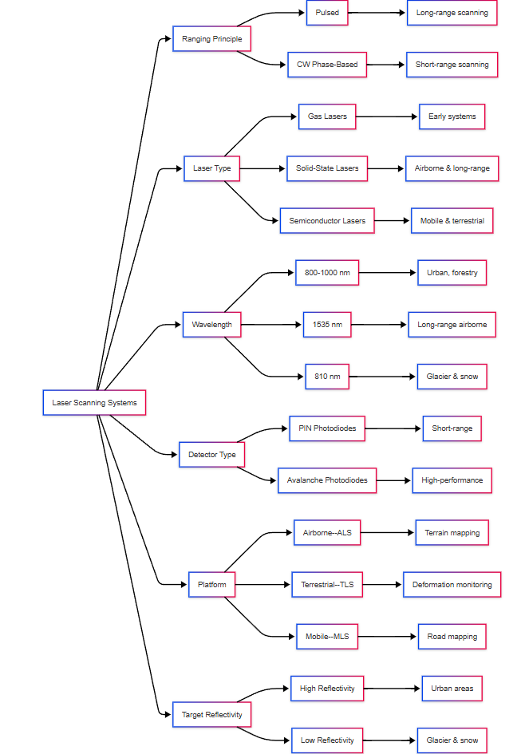
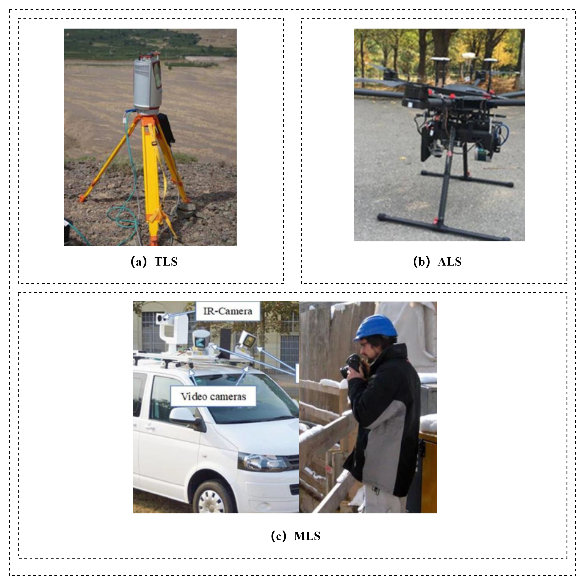
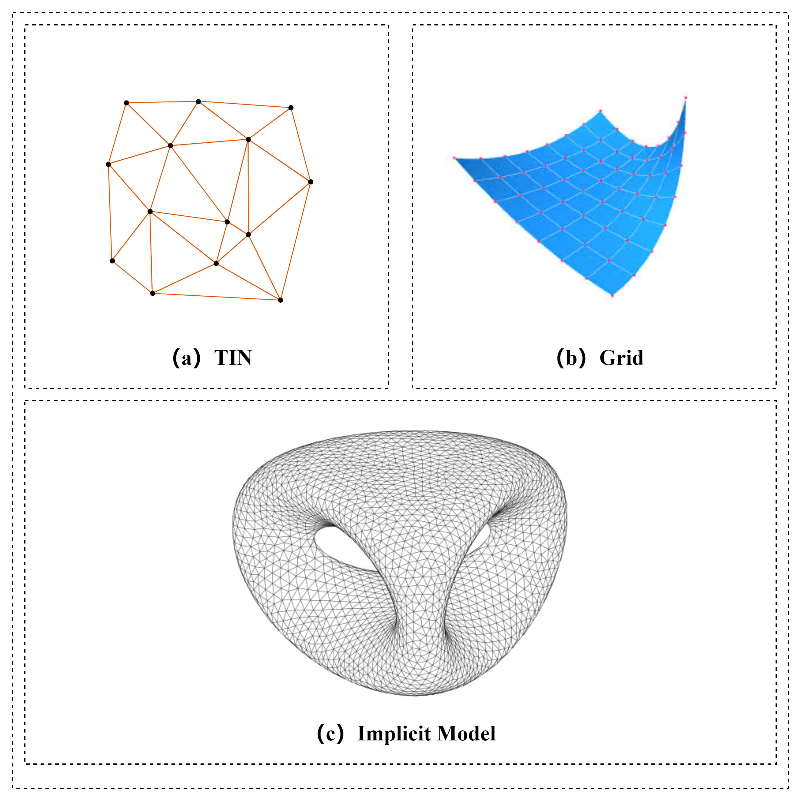
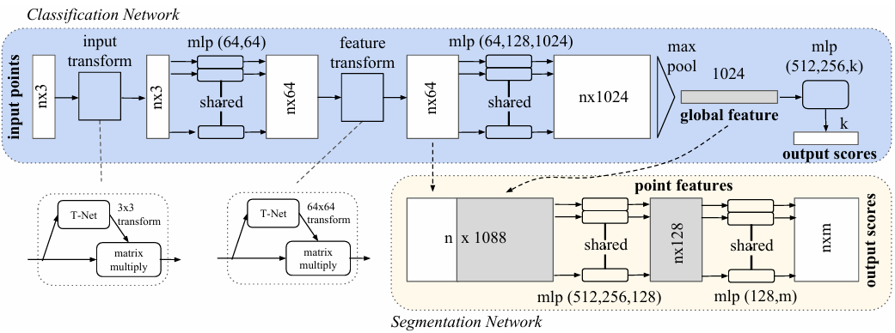
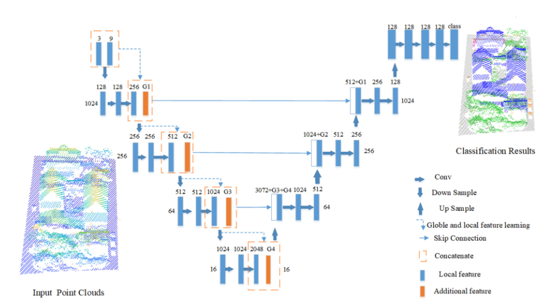

# Surface Modeling Techniques for Point Clouds Collected by Laser Scanners
> - PANZhiqing 24037665G

## 1. Introduction

Laser Scanning is a kind of new surveying technology, which can obtain a large number of data points with high-precision three-dimensional coordinates in a very short time, generally reaching 0.4 to 5.4 MB/hectare, so it is also considered as a big data production tool[@s18051641]. We can roughly classify the Laser Scanning system from the perspective of Laser source characteristics, carrying platform, target application, etc. For example, for large-scale urban scenes surveying and modeling, we can use a strong laser source combined with an airborne laser scanning system (ALS) and GPS/IMU positioning technology to obtain the required point cloud data; for some small-scale indoor scenes, we can use a laser source with a weaker laser source (eye-friendly) handheld laser scanning device (MLS) to obtain point cloud data.

> a) Terrestrial Laser Scanning (TLS) b) Airborne Laser Scanning (ALS) c) Mobile Laser Scanning (MLS)

Point cloud data (a common three-dimensional geometric data format) is just a series of points with coordinate information, which is a kind of unstructured data structure. This unstructured data has limited application scenarios, such as not being able to do further physical simulations (such as flow field simulation, collision detection), etc. In computer science and some other engineering fields, a continuous surface representation is needed to describe objects or scenes (triangular mesh, parameterized surface). Surface reconstruction of point cloud data is a very important research direction, which can convert point cloud data into continuous surface representation, so that it can be applied to more fields.

### 1.1 The Characteristics of Point Cloud Data

Laser scanning technology generates a large amount of point cloud data through non-contact acquisition, each point cloud data not only contains spatial coordinate information (x, y, z), but also may add different attribute information according to the principle of the scanning system[@9359340]. For example, a scanning system based on the principle of laser will add laser reflection intensity (Intensity) or the number of reflections recorded in the point cloud, while a system based on the principle of a camera will add color information (RGB). Many 3D scanners integrate laser and camera technology, which can obtain high-precision spatial coordinates, reflection intensity, color information, and language information simultaneously when scanning objects at close range, thus generating point cloud data containing multi-dimensional attributes. In addition, thanks to the "non-contact" measurement characteristics and flexible carrying platform, laser scanning technology is very flexible--from fine cultural relic modeling[@ijgi10090617] to kilometer-level terrain surveying and urban modeling[@8253517] can be effectively covered. The storage format of point cloud data is diverse, common formats include `.las`, `.laz` (industrial standard format of LiDAR data), `.pcd` (specified format of PCL library), `.obj` (3D model file format), `.pts` (a simple format containing only coordinate information), as well as `.xyz` and `.txt` text formats.

Point cloud data has a high degree of flexibility in specific applications, for example, it can directly present the collected information in a three-dimensional way, and if texture information is added, its visualization effect is not worse than that of triangular mesh. At the same time, point cloud data with multi-dimensional attributes has higher information content than general three-dimensional mesh. However, the geometric information expression of point cloud data for objects or scenes is "original" (unstructured), and this "original" (relative to data structures such as triangular mesh) data structure has many potential problems. For example, point cloud data has the problem of sparsity, that is, the spatial distribution is uneven, some places are too dense (such as vegetation areas), while other places are too sparse (such as occlusion areas); point cloud data is easily interfered by noise, factors such as air turbulence, vegetation occlusion, and ground reflection will lead to the degradation of point cloud data quality; more complex is that point cloud data also faces the coexistence contradiction of data redundancy (such as multiple echoes in vegetation areas) and data missing (such as occlusion areas). If you want to further analyze and process point cloud data, you have to use specific preprocessing algorithms to deal with point cloud data problems such as noise and sparsity, and then perform surface reconstruction and other operations.

Given that the original point cloud is usually unstructured, the processing and analysis of point clouds become complex. If a specific data structure can be used to restore the local geometry and spatial topology of the measured points, it will help improve the efficiency and performance of data processing. This kind of "optimized" point cloud data organization can be regarded as an "intermediate representation", which provides more geometric and topological information while retaining the original point cloud information, facilitating subsequent analysis and specific applications. Common point cloud data structures include point-based data structures, voxel-based data structures, and Patch-based organization.

Original point cloud data is just an unstructured three-dimensional point set, that is, unstructured point cloud. This data structure is simple and intuitive, but it requires traversing the entire point list to determine the adjacency relationship between points, which is computationally expensive. Point clouds can be organized based on fixed grids or three-dimensional grids to capture the topological structure between points, forming structured point clouds to accelerate calculations such as nearest neighbor search and subsequent processing.

Similar to pixels in two-dimensional images, voxels are the smallest unit in the three-dimensional world (in some algorithm concepts). Voxelization is essentially a downsampling, that is, approximating the original point cloud by a series of fixed-size voxels (regardless of how many points are in a single voxel). The octree is commonly used to organize voxels, dividing space recursively, and adjusting the size of each voxel as the level changes. Voxelization can simplify the representation of complex scenes and reduce computational costs. The maximum depth of the octree and the size of the voxel are two important parameters of voxelization, which need to be reasonably selected according to the specific application scenario.

Patch-based data structure is an intermediate representation between point cloud and voxel, which is a data organization form based on clustering and point cloud spatial distribution feature recognition, often implying the semantic information of local point cloud to some extent. Patch can be a supervoxel or superpoint, which is an over-segmentation of the point cloud, organizing points with similar features into patches through clustering, and using patches as the basic unit for further processing. Supervoxels can better maintain the boundaries between adjacent entities and improve computational efficiency. However, supervoxels are only an over-segmentation of the entire point cloud, and secondary clustering is needed to obtain a complete segmentation result.

### 1.2 Surface Representation Methods

In digital geography, surface models can be roughly divided into three categories: Triangulated Irregular Network (TIN), Grid, and Implicit Model. Each of these three models has its own advantages and disadvantages, and is suitable for different application scenarios [@Caumon2009].

The core idea of the triangulated mesh model is to use countless small triangular patches to approximate the real surface. This method is suitable for processing irregularly distributed data points, but is inefficient when processing large-scale data. The triangulated mesh model represents the surface of an object through vertices, edges, and faces, each face is usually a triangle or quadrilateral, and is suitable for most graphic applications. However, although the triangulated mesh model has high flexibility in representing complex geometric shapes, it may face challenges in computational efficiency when processing large-scale data. The core idea of the grid model is to divide three-dimensional space into small cubes (voxels), each voxel contains surface information. This method is suitable for regularly distributed data points and is widely used in medical imaging and geological modeling. However, the grid model may face the problem of insufficient accuracy when dealing with complex structures, especially in scenes that require high-resolution representation. Implicit models define surfaces through mathematical equations, suitable for handling complex topological structures, such as self-intersecting or multiply connected surfaces. The core idea of the implicit model is to use an implicit function to represent the surface, which performs well in handling complex structures.

Neural surface models have further developed in recent years, using neural networks to represent surfaces, a method known as neural surface models. The advantage of neural surface models is that they can easily represent complex geometric shapes, but the disadvantage is that they require a large amount of training data, and because of their complexity, they are difficult to interpret and adjust [@wang2021a].

In computer graphics and materials science, surface models and surface representation methods are also key concepts used to describe and analyze the surface morphology and properties of objects. In addition to the three models mentioned above, NURBS (Non-Uniform Rational B-Splines) is also a common surface representation method. NURBS uses rational B-spline functions to represent curves and surfaces, which can accurately describe complex free shapes and are widely used in CAD systems. In addition, parameterized models describe surfaces through parametric equations, which are commonly used in surface modeling and are suitable for scenarios that require precise control of surface shape.

Generally, the following excellent characteristics are required for the reconstructed three-dimensional surface: 1) high resolution and smoothness; 2) no gaps; 3) consistent with possible real data; 4) robustness to noise or incomplete input; 5) dense and compressed representation at the same time. These requirements are also the evaluation criteria for surface reconstruction methods [@10301359].

## 2. Methods and Techniques for Point Cloud Surface Modeling

### 2.1 Classical Methods: From Geometry-Driven to Data-Driven

Surface reconstruction from point clouds refers to creating a continuous surface so that it approximates the original surface from which the three-dimensional points are sampled[@10777531], that is, the process of converting three-dimensional point cloud data (the most common real-world three-dimensional data format) into other shape representations (such as mesh or implicit function) for subsequent applications (such as rendering, simulation, geometric processing).

#### 2.1.1 Grid-based Methods (Marching Cubes)
Based on the surface method usually directly generates a mesh, for example, by triangulating \( \Omega \). In contrast, volume-based methods usually require additional processing steps. If the implicit field is discretized into tetrahedra using three-dimensional Delaunay tetrahedralization (3DT), a mesh can be constructed from all triangles adjacent to an internal tetrahedron and an external tetrahedron.

One of the most popular methods for extracting a mesh from an implicit field is Marching Cubes, which discretizes the implicit function into voxels and takes a uniform grid value representing the discrete implicit field as input, and extracts a triangle mesh representing the zero value surface of the field, and finally extracts the union of all triangles as the reconstructed surface (mesh). The classic Marching Cubes algorithm determines the local grid topology and embedding by examining the signs of the eight vertices of each cube in the grid and referring to a predefined lookup table (indexed by sign configuration). If the isosurface intersects an edge of the cube, a new mesh vertex is added to that edge, and its position is calculated by linear interpolation. However, the Marching Cubes algorithm cannot effectively utilize neighbor information, so it cannot effectively recover sharp features. Recently, a neural network-optimized variant of Marching Cubes[@3480518] has been developed, which redesigns the embedding template to better preserve geometric features (including sharp edges and corners), and develops a neural network to learn vertex positions and mesh topology from training data, considering context information from neighboring cubes. The algorithm can effectively recover sharp features.

#### 2.1.2 Volume-based Methods (Poisson Surface Reconstruction)

Those methods partition a subset of \( \mathbb{R}^3 \) into interior (filled) and exterior (empty) subspaces. The surface is implicitly defined as the interface between these two subspaces. Most (but not all) such algorithms formulate the problem as finding an implicit function that indicates whether a point in space is filled (interior) or empty (exterior). Surfaces reconstructed using volume-based methods are guaranteed to be closed and non-self-intersecting.

Poisson Surface Reconstruction (PSR), this method reconstructs the implicit function by solving a partial differential equation[@1281965]. The method uses an adaptive resolution octree to represent the implicit expression representing the target surface model. This structure has high resolution near the model surface and low resolution far from the surface. This allows the algorithm to maintain high resolution while keeping low computational costs. PSR reconstructs the implicit function by solving the Poisson equation, the solution of which is a smooth surface that can be extracted into a triangular mesh using an isosurface extraction algorithm.

However, the Poisson surface reconstruction algorithm lacks accuracy evaluation metrics for the reconstruction results, making it difficult to quantify the uncertainty in the reconstruction process, which to some extent reduces the reliability of the method. Based on the statistical derivation of Gaussian Process (GP), the uncertainty information of the surface shape in the Poisson surface reconstruction process can be analyzed. This method is called Stochastic Poisson Surface Reconstruction (SPSR)[@3555441].

### 2.2 Inovations: Intelligence and Automation

Compared with surface reconstruction methods that require manual intervention, deep learning technology often uses "end-to-end" learning to directly learn features from raw data, improving data processing efficiency. At the same time, for some complex cases, deep learning-based methods also show excellent quantitative and qualitative performance. [@10301359]

PointNet [@qi2017pointnetdeeplearningpoint] is the first end-to-end deep learning framework that directly processes unordered point clouds. This framework directly processes raw point clouds, retains geometric details, and avoids geometric information loss caused by pre-voxelization or projection. By aggregating point features with symmetric functions (such as max pooling), it maintains permutation invariance without the need for manual feature extraction. The PointNet network consists of classification and segmentation networks, which accept n unordered points $P = \{p_1, p_2, \ldots, p_n\}$ as input and output classification scores or segmentation scores for each point. The network uses skip connections and feature transformation networks to capture local and global information through multi-scale feature learning, and has strong adaptability to uneven point cloud density, noise, and occlusion, making it suitable for efficient processing of large-scale ALS point clouds.

PointNet++ [@rs13030472] introduces a hierarchical structure based on PointNet, capturing local and global information through multi-scale feature learning (sampling layer, grouping layer, PointNet layer). In addition, in feature propagation, the model interpolates based on point-to-point distance and elevation differences, optimizing the classification results using the elevation distribution characteristics of ALS point clouds. By combining multi-scale local features and global features, it supports semantic segmentation and object recognition of complex scenes (such as urban buildings and vegetation), providing high-precision classification results for subsequent reconstruction.

In addition, neural networks can also be used to represent implicit surfaces. NeRF [@wang2021a] is a method that generates an implicit representation of the observed scene by learning multiple-angle images, which can generate realistic three-dimensional scenes. Different from strict surface reconstruction, NeRF can be considered as a "neural rendering" technology, which not only learns the implicit surface function, but also learns the radiative transfer equation of the scene. The NeRF network can be combined with LiDAR point clouds to reconstruct three-dimensional scenes, helping to improve the quality of subsequent surface reconstruction. [@Zhang_Zhang_Kuang_Zhang_2024]

## 3. Application Scenarios and Technical Demands

### 3.1 Natural Environment Modeling

Lidar point clouds can be used for natural environment modeling, such as vegetation modeling, natural terrain modeling, etc. Vegetation modeling can be further subdivided into tree modeling, shrub modeling, etc. Tree modeling is mainly used in the field of forest management, and 3D tree models are widely used for visualization enhancement and tree characteristic prediction. In tree point cloud modeling, procedural methods (such as L-systems) are an interesting numerical modeling method that generates tree models by simulating tree growth rules. In addition, tree models can be obtained based on image recognition and scanning. [@8253517]

Generally speaking, before tree modeling, vegetation detection and single tree segmentation are usually required, and then point cloud skeletonization, geometric/topological inference, adding leaves and twigs (usually using L-systems), etc. are required. The reconstruction methods of tree skeleton structure mainly include volume method, K-means clustering and cylinder fitting, global optimization and Laplacian smoothing, etc.

Given that natural surfaces generally have complex geometric features, such as sharp edges, rough surfaces, etc., these features are often difficult to express mathematically and even more difficult to model and analyze. Therefore, deep learning-based methods have broad application prospects in natural environment modeling. For example, PointNet++ can be used for segmentation modeling of point clouds in complex natural scenes, and NeRF can be used to reproduce realistic scene effects. In addition, deep learning-based methods can also be used for vegetation detection, vegetation segmentation, vegetation classification, etc. In complex scenes, deep learning methods have certain advantages over traditional algorithms.

### 3.2 Urban and Architectural Digitization

Another important application scenario of surface reconstruction technology based on large-scale laser point cloud data is urban modeling to support specific applications such as smart cities and digital cities. Urban modeling mainly includes building reconstruction and modeling, other objects in the urban environment (such as trees, infrastructure, and sculptures), roads, bridges, power lines, etc. Urban laser point cloud acquisition methods include airborne laser scanning (ALS), unmanned aerial vehicle laser scanning (UAV-LS), and mobile laser scanning (MLS). Generally speaking, mobile laser scanning (MLS) is commonly used for modeling small urban areas.

The reconstruction of urban buildings is an important part of urban modeling. Considering that urban buildings have diverse styles, a wide range of construction times, and diverse uses, such as ancient buildings, modern buildings, industrial buildings, commercial buildings, etc., the reconstruction of urban buildings is a relatively complex process. In terms of architectural style, buildings with sharp lines (such as spires, etc.) have significant differences in the reconstruction process from buildings with more curves (such as domes). In terms of the construction time of the building, the improper protection of early buildings often leads to damage to the building or the phenomenon of "symbiosis" with new buildings, so the reconstruction of the building needs to consider the historical changes of the building. Therefore, the reconstruction of buildings especially needs to select and design reconstruction algorithms based on the specific characteristics of the building, in order to fully utilize the geometric information of the input data to generate building models.

## 4. Discussion

We can find that the complexity of point cloud data comes not only from its own characteristics such as large quantity, high dimension, and unstructuredness, but also from the diversity of application scenarios and subdivision fields. In different application scenarios, the processing methods, surface reconstruction techniques, algorithm optimization, etc. of point cloud data are different. It can be said that the processing of point cloud data and surface reconstruction is a multidisciplinary research field that requires knowledge from computer science, geographic information science, architecture, cultural heritage protection, and other fields. Therefore, the future research direction should be interdisciplinary, combining experts from different fields to jointly promote the development of point cloud data processing and surface reconstruction technology.

## References