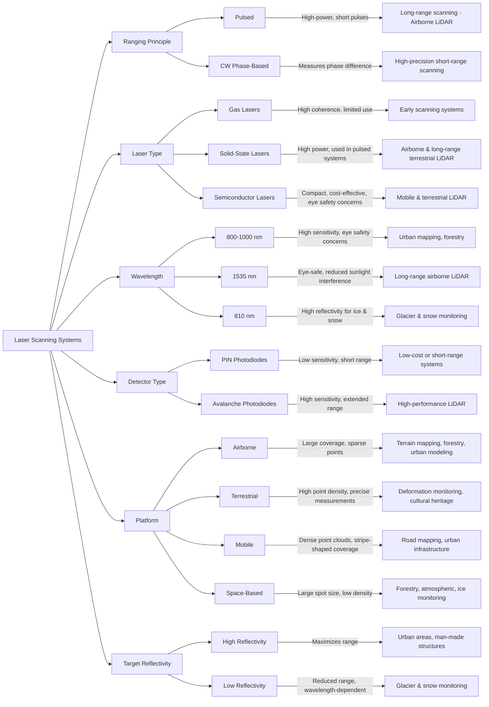

# Surface Modeling Techniques for Point Clouds Collected by Laser Scanners( 基于激光扫描点云的表面建模技术：方法、应用与挑战 )
> - PANZhiqing 24037665G

## 1. Introduction

Laser Scanning 是一种新型测绘技术，可以在极短的时间内获取大量带有高精度三维坐标的数据点（point clouds），一般情况下能够达到0.4 到 5.4 MB/hectare，因此也被认为是一种大数据生产工具[@s18051641]。 我们可以从 Laser 光源特性、搭载平台、目标应用等角度对 Laser Scanning 系统进行粗略分类。举例来说，对于较大规模的城市场景进行测绘及建模，我们可以使用较强的激光光源结合机载激光扫描系统（ALS）并结合 GPS/IMU 定位技术来获取所需的点云数据；而对于一些小尺度的室内场景，我们可以使用激光光源较弱的（人眼友好型）手持激光扫描设备（TLS）来获取点云数据。

Laser Scanning is a new surveying technology that can obtain a large number of data points with high-precision three-dimensional coordinates in a very short time, generally reaching 0.4 to 5.4 MB/hectare, so it is also considered a big data production tool. [@s18051641] We can roughly classify the Laser Scanning system from the perspective of Laser light source characteristics, platform, target application, etc. For example, for large-scale urban scene surveying and modeling, we can use a strong laser light source combined with an airborne laser scanning system (ALS) and GPS/IMU positioning technology to obtain the required point cloud data; for some small-scale indoor scenes, we can use a laser light source. Weak (eye-friendly) handheld laser scanning device (TLS) to obtain point cloud data.

### 1.1 点云数据特征

Laser Scanning 会产生大量

.las、.laz：LiDAR数据的工业标准格式，是一种二进制文件格式。
.pcd：PCL库官方指定格式。
.obj：由Alias|Wavefront Techonologies公司从几何学上定义的3D模型文件格式，是一种文本文件。
.pts：被称之为最简便的点云格式，属于文本格式。只包含点坐标信息，按X Y Z顺序存储。
.xyz、.txt：一种文本格式。

激光扫描系统

回到我们刚才提到的问题：点云中每个点存储的数据内容是什么？

若使用激光原理得到的点云，每个点除空间坐标(x,y,z)外，还包含激光反射强度(Intensity)
若使用摄像头原理得到的点云，每个点除空间坐标(x,y,x)外，还包含颜色信息(RGB)
对于很多 3D 扫描仪来说，能够在近距离对物体扫描得出 3D 模型，包括物体颜色。实际上是摄像头加其他测量工具综合得到的数据结果。
若使用激光原理 + 摄像头原理得到的点云，每个点除空间(x,y,z)外，还可以同时包含激光反射强度(Intensity) 和 颜色信息(RGB)。

所生产的数据是

   - 激光扫描技术：从脉冲式到相位式扫描的原理差异，强调其高精度、非接触式采集能力。
   - 点云数据特征：三维坐标+属性（反射强度、颜色）的多维度特性，分析其非结构化、稀疏性与噪声敏感性。
   - 关键挑战：数据冗余（如植被多次回波）与缺失（如遮挡区域）的共存矛盾。
   
   分析与评论：  
   > 激光扫描技术的核心优势在于其适应性——从毫米级文物建模到公里级地形测绘均可覆盖，但点云数据的“原始性”导致其无法直接用于工程应用，需依赖表面建模技术实现从离散点到连续表面的跃迁。

### 1.2 数据处理流程优化
   - 预处理关键步骤：去噪（统计滤波 vs. 半径滤波）、配准（ICP算法 vs. 特征匹配）、降采样（体素网格 vs. 曲率敏感采样）。
   - 精度控制策略：扫描仪标定误差、多站点云融合的累积误差传播模型。

   案例对比：  
   > 在文化遗产数字化中，基于反射强度的噪声过滤优于几何滤波，可保留雕刻纹理细节；而地形建模中，体素降采样可显著提升处理效率，但可能弱化微地形特征。

## 2. Methods and Techniques for Point Cloud Surface Modeling

> 表面建模方法的技术谱系与创新

### 2.1 经典方法：从几何驱动到数据驱动
   - 网格化建模：Delaunay三角网在地形建模中的统治地位，Voronoi图在特征边缘提取中的优势与局限性。
   - 参数化曲面：B样条/NURBS在工业设计中的光滑表面重建，但对非均匀点云的适应性不足。
   - 体素建模：医学影像领域的迁移应用，通过八叉树压缩实现大规模点云高效处理。

   技术批判：  
   > 传统方法依赖人工参数调整（如Delaunay的阈值设定），导致建模结果的主观性。而体素建模虽提升了效率，但分辨率与细节保留的权衡仍是核心矛盾。

### 2.2 算法革新：智能化与自动化
   - ICP算法的演进：从刚性配准到非刚性变形（如薄板样条插值），应对扫描对象形变问题。
   - 深度学习介入：PointNet++等网络直接处理无序点云，实现端到端的表面重建（如从碎片化点云生成水密网格）。

   趋势分析：  
   > 传统算法（如泊松重建）依赖全局优化，而AI驱动的方法通过局部特征学习更适应复杂场景，但需解决小样本训练与物理可解释性的矛盾。

## 3. Application Scenarios and Technical Demands
> 应用场景驱动的技术差异化需求

### 3.1 自然环境建模
   - 地形与植被：LiDAR点云的地表滤波算法（如布料模拟滤波）分离植被与地面，结合生态参数反演树冠结构。
   - 动态场景挑战：时序点云在滑坡监测中的应用，需解决表面形变追踪与噪声抑制的平衡。

### 3.2 城市与建筑数字化
   - 建筑立面重建：平面拟合+RANSAC算法提取规则结构，结合BIM实现语义化建模。
   - 城市级建模瓶颈：亿级点云的实时渲染难题，LOD（细节层次）技术与云计算的结合策略。

### 3.3 文化遗产与虚拟现实
   - 高保真重建：亚毫米级扫描结合纹理映射，实现石窟壁画的数字修复。
   - VR/AR适配：轻量化网格与法线贴图生成，平衡沉浸感与计算负载。

   跨领域启示：  
   > 建筑领域的规则驱动建模（如基于IFC标准）可为自然场景建模提供结构化先验知识，而文化遗产的高精度要求推动硬件（如光谱LiDAR）与算法（如超分辨率重建）的协同创新。

## 4. Future Trends and Challenges
> 未来趋势：融合、智能与实时化

### 4.1 多源数据融合范式
   - 激光-影像融合：点云的几何精度与影像的纹理信息互补，无人机倾斜摄影的混合采集趋势。
   - 跨模态学习：点云-文本跨模态检索（如“检索古建筑中所有斗拱构件”），需突破非结构化数据语义鸿沟。

### 4.2 实时表面建模的突破
   - 边缘计算架构：车载LiDAR的在线表面重建，满足自动驾驶实时障碍物识别需求。
   - 神经隐式表示：NeRF与点云结合，实现动态场景的实时辐射场建模。

### 4.3 可持续性挑战
   - 能耗问题：激光扫描设备功耗与数据处理中心的碳足迹，绿色算法设计需求。
   - 伦理与隐私：城市级扫描中个人隐私泄露风险，需发展差分隐私点云脱敏技术。

   研究展望：  
   > 表面建模将从“几何重建”转向“语义理解”，通过知识图谱嵌入实现智能场景解析。同时，量子计算可能颠覆传统优化算法，解决NP-hard级别的全局优化问题。

## 5. Conclusion

激光扫描点云表面建模技术已形成从数据采集到智能应用的完整链条，但其发展仍受限于三组矛盾：效率与精度的博弈、自动化与可控性的冲突、通用性与场景特异性的平衡。未来研究需以“场景定义技术”为导向，结合物理模型与数据驱动方法，构建兼具数学严谨性与工程实用性的新一代建模框架。