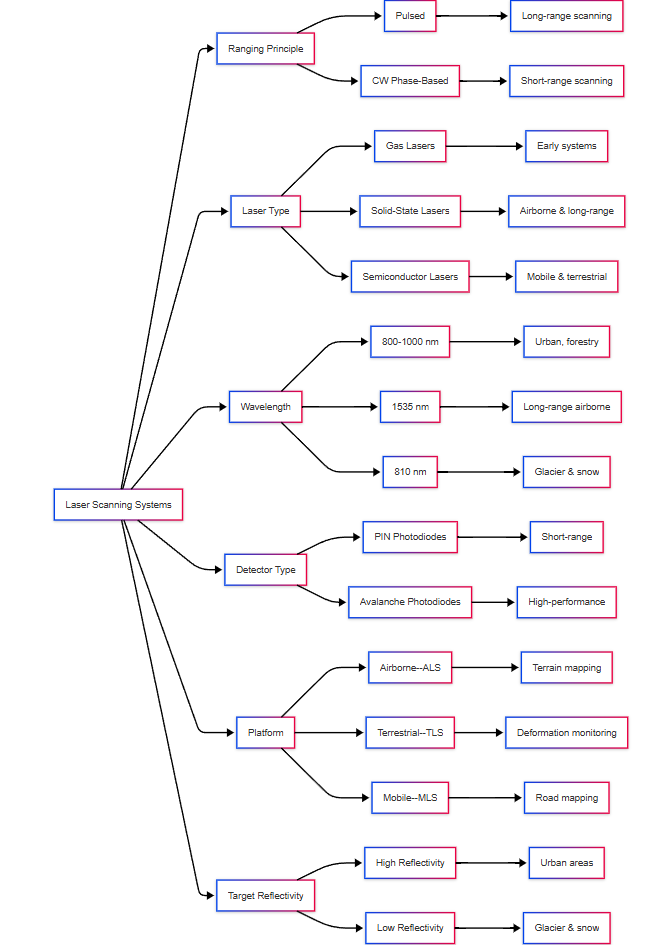
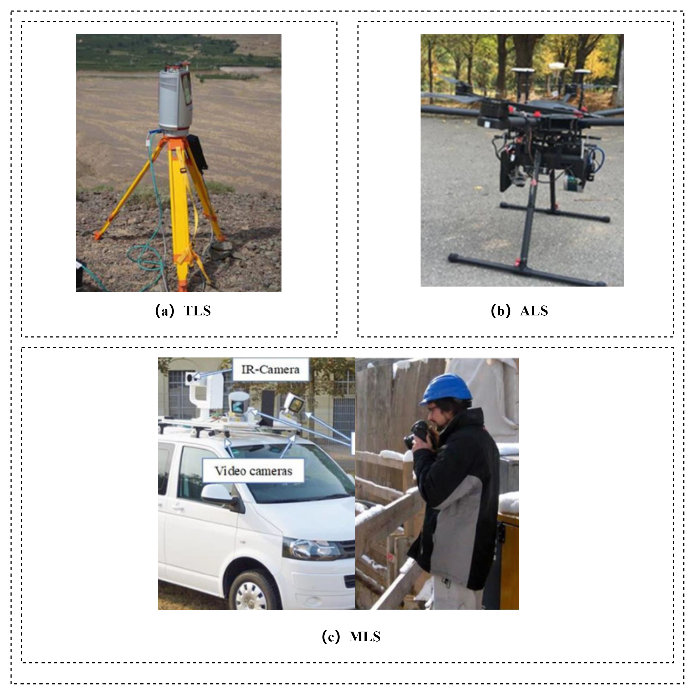
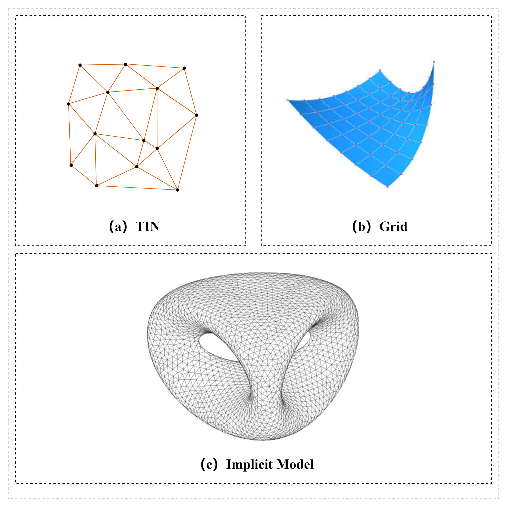
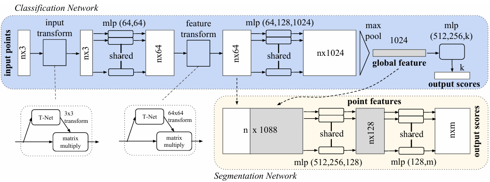
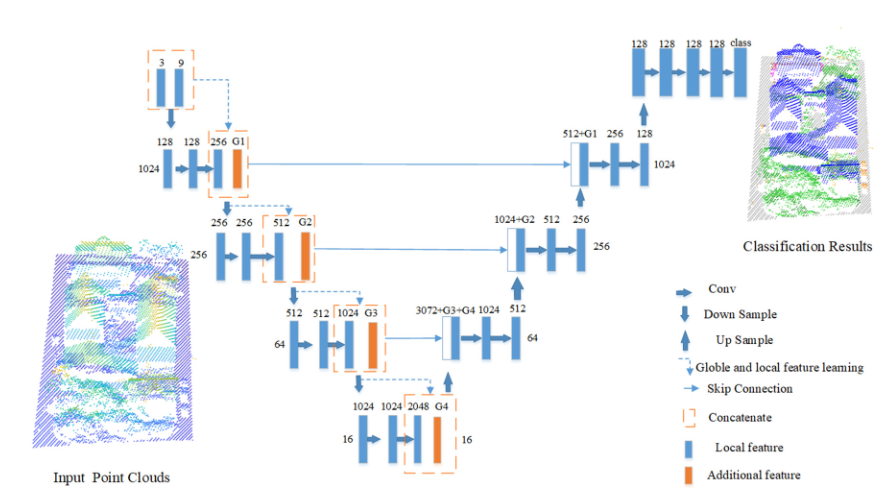

# Surface Modeling Techniques for Point Clouds Collected by Laser Scanners
> - PANZhiqing 24037665G

## 1. Introduction

Laser Scanning 是一种新型测绘技术，可以在极短的时间内获取大量带有高精度三维坐标的数据点（point clouds），一般情况下能够达到0.4 到 5.4 MB/hectare，因此也被认为是一种大数据生产工具[@s18051641]。 我们可以从 Laser 光源特性、搭载平台、目标应用等角度对 Laser Scanning 系统进行粗略分类。举例来说，对于较大规模的城市场景进行测绘及建模，我们可以使用较强的激光光源结合机载激光扫描系统（ALS）并结合 GPS/IMU 定位技术来获取所需的点云数据；而对于一些小尺度的室内场景，我们可以使用激光光源较弱的（人眼友好型）手持激光扫描设备（MLS）来获取点云数据。

> a) Terrestrial Laser Scanning (TLS) b) Airborne Laser Scanning (ALS) c) Mobile Laser Scanning (MLS)

点云数据（常见的三维几何数据格式）仅仅是一些列带有坐标信息的点，是一种非结构化的数据结构。这种非结构化的数据应用场景有限，例如不能做进一步的物理模拟（诸如流场模拟、碰撞检测）等。在计算机科学及其他一些工程领域，需要一种连续的表面表示来描述物体或场景（三角网格、参数化曲面）。点云数据的表面重建是一个非常重要的研究方向，它可以将点云数据转换为连续的表面表示，从而可以应用到更多的领域中。

### 1.1 点云数据特征及组织形式

激光扫描技术通过非接触式采集方式生成大量点云数据，每个点云数据不仅包含空间坐标信息（x, y, z），还可能根据扫描系统的原理附加不同的属性信息[@9359340]。例如，基于激光原理的扫描系统会在点云中加入激光反射强度（Intensity）或是记录到的反射次数，而基于摄像头原理的系统则会附加颜色信息（RGB）。许多3D扫描仪综合了激光和摄像头技术，能够在近距离扫描物体时同时获取高精度的空间坐标、反射强度、颜色信息和语言信息，从而生成包含多维属性的点云数据。此外，得益于“非接触式”测量特性及灵活的搭载平台，激光扫描技术还十分的灵活--从精细文物建模[@ijgi10090617]到公里级地形测绘及城市建模[@8253517]均可有效覆盖。点云数据的存储格式多样，常见的包括`.las`、`.laz`（LiDAR数据的工业标准格式）、`.pcd`（PCL库指定格式）、`.obj`（3D模型文件格式）、`.pts`（仅包含坐标信息的简便格式）以及`.xyz`和`.txt`等文本格式。

点云数据在具体应用中具有高度灵活性，例如可以直接以三维的方式呈现搜集到的信息，若再附加纹理信息其可视化效果并不比三角网格差，同时，带有多维属性的点云数据也比一般的三维网格具有更高的信息量。然而，点云数据对于物体或场景的几何信息表达是“原始的”（非结构化的），这种“原始的（相对于三角网格等数据结构而言）”数据结构存在存在诸多潜在的问题。例如，点云数据存在稀疏性问题，即空间分布不均匀，一些地方过分稠密（例如植被区域），而另一些地方则过分稀疏（例如遮挡区域）；点云数据容易受到噪声的干扰，空气湍流、植被遮挡、地面反射等因素都会导致点云数据的质量下降；更为复杂的是，点云数据还面临数据冗余（如植被区域的多次回波）与数据缺失（如遮挡区域）的共存矛盾。若希望进一步分析处理点云数据，就不得不使用特定的预处理算法来处理存在噪声、稀疏性等问题的点云数据，而后再进行表面重建等操作。

考虑到原始点云通常是无结构的，这使得点云的处理和分析变得复杂。如果能采用特定的数据结构恢复测量点的局部几何和空间拓扑，将有助于提高数据处理的效率和性能。这类“优化的”点云数据组织形式可以看作是一种“中间表达”，它在保留原始点云信息的同时，提供了更多的几何和拓扑信息，为后续分析及具体应用提供便利。常见的点云数据结构包括基于点的数据结构、基于体素（Voxel）的数据结构和基于Patch的组织方式。[@9359340]

最原始的点云数据就是无结构的三维点集合，即非结构化点云。这种数据结构简单直观，但在处理时需要遍历整个点列表来确定点之间的邻接关系，计算成本较高。可以基于固定的栅格或三维网格来组织点云，捕捉点间拓扑结构，形成结构化点云，以便加速最邻近查找等计算过程，加速后续计算处理。

与二维图像中的像素相类似，体素是（某些算法概念中）三维世界中的最小组成单元。体素化本质上是一种降采样，即通过一个个固定大小的体素来近似表示原始点云（不论单个体素内有多少点）。常用八叉树组织体素，通过递归划分空间，每个体素的大小随着层级变化而调整。体素化可以简化复杂场景的表示，减少计算成本。八叉树的最大深度和体素大小是体素化的两个重要参数，需要根据具体应用场景进行合理选择。

基于Patch的数据结构是一种介于点云和体素之间的中间表达形式，它是一种基于聚类与点云空间分布特征识别的数据组织形式，往往一定程度上暗示了局部点云的语言信息。Patch可以是超体素（Supervoxel）或超点（Superpoint），它们是对点云的过分割，通过聚类将具有相似特征的点组织为补丁，以补丁作为基本单元进行进一步处理。超体素可以更好地保持邻近实体之间的边界，提高计算效率。然而，超体素仅是对整个点云的过分割，需要进行二次聚类以获得完整的分割结果。

### 1.2 表面表示方法

在数字地理学科中，表面模型大致可以分为三类：三角网格模型（Triangulated Irregular Network, TIN）、栅格模型（Grid）和隐式模型（Implicit Model）。这三种模型各有优劣，适用于不同的应用场景 [@Caumon2009]。

三角网格模型的核心思想是使用无数细小的三角面片去逼近真实曲面。这种方法适用于处理不规则分布的数据点，但在处理大规模数据时效率较低。三角网格模型通过顶点、边和面来表示物体的表面，每个面通常是三角形或四边形，适用于大多数图形应用。然而，尽管三角网格模型在表示复杂几何形状时具有较高的灵活性，但其在处理大规模数据时可能会面临计算效率的挑战。栅格模型的核心思想是将三维空间划分为一个个小的立方体（体素），每个体素包含表面信息。这种方法适用于规则分布的数据点，广泛应用于医学成像和地质建模等领域。然而，栅格模型在处理复杂结构时可能会面临精度不足的问题，尤其是在需要高分辨率表示的场景中。隐式模型通过数学方程定义曲面，适用于处理复杂的拓扑结构，如自相交或多重连接的表面。隐式模型的核心思想是使用一个隐式函数来表示曲面，这种方法在处理复杂结构时表现出色。

近年来，隐式表面模型进一步发展，使用神经网络来表示曲面，这种方法被称为神经表面模型。神经表面模型的优点是可以很容易地表示复杂的几何形状，但其缺点是需要大量的训练数据，并且由于其复杂性，难以解释和调整 [@wang2021a]。

在计算机图形学和材料科学中，表面模型和表面表示方法同样是用于描述和分析物体表面形态和性质的关键概念。除了上述三类模型，NURBS（Non-Uniform Rational B-Splines）也是一种常见的表面表示方法。NURBS 使用有理 B 样条函数来表示曲线和曲面，能够精确描述复杂的自由形状，广泛应用于 CAD 系统中。此外，参数化模型通过参数化方程描述表面，常用于曲面建模，适用于需要精确控制曲面形状的场景。

通常，要求重建后的三维表面具有如下优良特性：1）高分辨率和光滑；2）无缝隙；3）与可能的真实数据一致；4）对噪声或不完整输入具有鲁棒性；5）同时具有密集和压缩的表示。这些要求也是表面重建方法的评价标准 [@10301359]。

## 2. Methods and Techniques for Point Cloud Surface Modeling

### 2.1 经典方法：从几何驱动到数据驱动

从点云重建曲面是指创建一个连续的曲面以使其近似于从中采样三维点的原始曲面[@10777531]，即将三维点云数据（最常见的真实世界三维数据格式）转换为其他形状表示（如网格或隐函数）的过程，以供后续应用使用（如渲染、仿真、几何处理）。

#### 2.1.1 网格化方法（Marching Cubes）
基于曲面的方法通常直接生成网格，例如通过对 \( \Omega \) 进行三角剖分。相比之下，基于体积的方法通常需要额外的处理步骤。如果隐式场使用三维 Delaunay 四面体剖分（3DT）离散化为四面体，则可以从所有与一个内部四面体和一个外部四面体相邻的三角形构建网格。

从隐式场提取网格的最流行方法之一是 Marching Cubes，它将隐式函数离散化为体素，以一个表示离散隐式场的均匀网格值作为输入，并提取表示该场零等值面的三角网格，最终提取所有三角形的并集作为重建曲面（mesh）。经典的 Marching Cubes 算法通过检查网格中每个立方体八个顶点的符号，并参考一个预定义的查找表（按符号配置索引）来确定局部网格拓扑结构和镶嵌方式。如果等值面与立方体的某个边相交，就会在该边上添加一个新的网格顶点，并通过线性插值计算其位置。然而，Marching Cubes 算法无法有效利用邻居信息，因此它无法有效恢复尖锐特征。最近，Marching Cubes 的神经网络优化变体[@3480518]通过重新设计镶嵌模板，使其更适合保留几何特征（包括尖锐边缘和角点），并开发了一个神经网络来从训练数据中学习顶点位置和网格拓扑，以考虑来自邻近立方体的上下文信息。该算法可以有效地恢复尖锐特征。

#### 2.1.2 基于体积的方法（泊松表面重建）

这些方法将 \( \mathbb{R}^3 \) 的一个子集划分为内部（内部）和外部（外部）子空间。曲面被隐式定义为这两个子空间之间的界面。大多数（但不是全部）此类算法将问题表述为找到一个隐式函数，指示空间中的点是满的（内部）还是空的（外部）。使用基于体积的方法重建的曲面保证是封闭且无自交的。

泊松表面重建（Poisson Surface Reconstruction, PSR），该方法通过求解偏微分方程来重建隐函数[@1281965]。该方法使用自适应分辨率八叉树来表示代表目标表面模型的隐式表达。这种结构在模型表面附近具有高分辨率，而在远离表面处具有较低分辨率。这使得该算法能够在保持高分辨率的同时，保持较低的计算成本。PSR 通过求解泊松方程来重建隐式函数，该方程的解是一个光滑的曲面，可以通过等值面提取算法来提取三角网格。

然而，泊松表面重建算法缺少重建的结果精度评价指标，难以量化重建过程中的不确定性，这个问题从一定程度上降低了该方法的可靠性。基于高斯过程（Gaussian Process, GP） 的统计推导，可分析出泊松表面重建过程中表面形状的不确定性信息。这种方法被称为随机泊松表面重建（Stochastic Poisson Surface Reconstruction, SPSR）[@3555441]。

### 2.2 算法革新：智能化与自动化

相较于传统算法需要人工干预的表面重建方法，深度学习技术往往采用“端到端”学习的方式，直接从原始数据中学习特征，提高数据处理效率。同时，对于一些复杂情况，基于深度学习的方法也表现出优异的定量和定性性能。[@10301359]PointNet [@qi2017pointnetdeeplearningpoint] 是首个直接处理无序点云的端到端深度学习框架，该框架直接处理原始点云，保留几何细节，避免预先体素化或投影导致的几何信息损失。通过对称函数（如最大池化）聚合点特征，保持置换不变性，无需手工提取特征。

与传统的图像或体素方法不同，PointNet 直接在无序点集合上进行学习。

PointNet 处理点云数据的方法是：
\[
\{x_1, x_2, ..., x_n\} \subset \mathbb{R}^d \to \text{无序点集} \tag{2.1}
\]
利用 MLP（多层感知机）学习特征：
\[
f(x_1, x_2, ..., x_n) = \gamma\left(\max_{i=1,...,n} h(x_i) \right) \tag{2.2}
\]

其中：
- \( h \) 和 \( \gamma \) 均为 MLP，
- 通过最大池化（Max Pooling）操作提取全局特征。

PointNet 网络由分类网络和分割网络组成，该网络接受n个无序点$P = \{p_1, p_2, \ldots, p_n\}$作为输入，输出为每个点的分类分数或分割分数。该网络采用跳跃连接和特征变换网络，通过多尺度特征学习捕捉局部和全局信息，对点云密度不均、噪声和遮挡具有较强适应性，适用于大范围ALS点云的高效处理。然而，PointNet 缺少对局部几何结构的建模能力，因此 PointNet++ 通过层次化特征学习来改进。

PointNet++ [@rs13030472] 则是在 PointNet 基础上引入层次化结构，通过多尺度特征学习（采样层、分组层、PointNet 层）捕捉局部和全局信息，此外，在特征传播中，该模型结合点间距离和高程差异进行插值，利用ALS点云的高程分布特性优化分类结果。其通过多尺度局部特征和全局特征的结合，支持复杂场景（如城市建筑、植被）的语义分割和对象识别，为后续重建提供高精度分类结果。

PointNet++ 通过层次化抽象 (Hierarchical Set Abstraction)来提取局部和全局特征，主要包括: 采样层（Sampling Layer，选择局部区域的中心点（centroids），用于特征提取）、分组层（Grouping Layer，选择中心点周围的“邻近点”构造局部区域）及 PointNet 层（Mini-PointNet，在每个局部区域内应用 PointNet 以提取局部特征）。

PointNet++ 通过多级采样、分组和特征提取，生成不同尺度的点云特征，然后经过全连接层 (Fully Connected Layers) 输出类别预测。最终，采用插值（Interpolation）策略，使低级特征与高级特征结合，进行点级预测。

对于局部采样，其采用迭代最远点采样（Iterative Farthest Point Sampling, FPS）策略来选取代表性点：
\[
\{x_{i_1}, x_{i_2}, ..., x_{i_m} \} \subset \{x_1, x_2, ..., x_n\} \tag{2.3}
\]
其中，\( x_{i_j} \) 是集合 \(\{x_1, ..., x_{i_{j-1}}\}\) 中最远的点。

此外，也可使用神经网络来表示隐式曲面。NeRF [@wang2021a] 是一种通过学习多角度图片来生成所观察场景的隐式表达的方法，它可以生成逼真的三维场景。与严格意义上的表面重建不同，NeRF 可以认为是一种“神经渲染”技术，它并不仅仅学习隐式表面函数，还一同学习了场景的辐射传输方程。NeRF 网络可以与 LiDAR 点云相结合，重建三维场景，助力提高后续表面重建的质量。[@Zhang_Zhang_Kuang_Zhang_2024]

## 3. Application Scenarios and Technical Demands
> 应用场景驱动的技术差异化需求

### 3.1 自然环境建模

Lidar点云可以用于自然环境建模，例如植被建模、自然地形建模等。而植被建模又可以细分出树木建模、灌木建模等。树木建模主要用于森林管理领域，3D树木模型被广泛用于可视化增强和树木特性预测。在树木点云建模中程序化方法（如L系统）是一种有趣的数目建模方法，通过模拟树木生长规律生成树木模型。此外还可以基于图像识别和扫描获取树木模型。[@8253517]

一般而言，在进行树木建模之前，通常需要进行植被检测和单棵树分割，而后需要进行点云骨架化、几何/拓扑推断、添加叶子和细枝（通常使用L系统）等步骤。树木骨架结构的重建方法主要有体积方法、K均值聚类及圆柱拟合、全局优化及Laplacian平滑等。

考虑到自然表面一般具有复杂的几何特征，例如尖锐边缘、粗糙表面等，这类特征往往难以使用数学方式表达，更加难以建模与分析。因此，基于深度学习的方法在自然环境建模中具有广泛的应用前景。例如，PointNet++  [@rs13030472]可以用于复杂自然场景的点云进行分割建模，NeRF 可以用于重现逼真的场景影响。此外，基于深度学习的方法还可以用于植被检测、植被分割、植被分类等任务。在复杂场景下，相比于传统算法，深度学习方法具有一定的优势。

### 3.2 城市与建筑数字化

基于大规模激光点云数据的表面重建技术在智慧城市和数字化城市的建设中扮演着至关重要的角色。城市建模不仅包括建筑物的重建与建模，还涉及城市环境中其他对象的数字化，如树木、基础设施、雕塑、道路、桥梁、电力线等。这些对象的数字化为城市规划、交通管理、灾害应对等提供了重要的数据支持。城市激光点云的获取方式多种多样，常见的包括机载激光扫描（ALS）、无人机激光扫描（UAV-LS）和移动激光扫描（MLS）。对于较小规模的城市片区建模，移动激光扫描（MLS）因其灵活性和高精度而成为首选。

城市建筑物的重建是城市建模的核心任务之一。由于城市建筑物的风格多样、建成时间跨度大、用途各异（如古代建筑、现代建筑、工业建筑、商业建筑等），建筑物的重建过程相对复杂。建筑物风格的多样性使得重建算法需要具备高度的适应性。例如，多尖锐线条的建筑（如尖顶建筑）与多弧线的建筑（如拱顶建筑）在重建过程中需要采用不同的算法。此外，建筑物的历史变迁也是重建过程中需要考虑的重要因素。建成较早的建筑可能因保护不当而出现损坏，或与新建筑“共生”，这些情况都增加了重建的难度。因此，建筑的重建需要针对建筑的具体特征，选择和设计合适的重建算法，以充分利用输入数据的几何信息生成高精度的建筑模型。

通常，一个完整的建筑模型由几何、拓扑和语义三部分组成：几何描述建筑的形状、尺寸及结构组件的空间位置；拓扑描述建筑结构组件的存在及其相邻关系；语义表示建筑模型的功能属性。语义丰富的建筑模型具有明确的结构组件标签，如墙壁、屋顶、柱子等，有助于模型编辑和应用。在建筑物重建的过程中，大多数算法生成的是三角网格模型，但也有部分算法构建包含平面或Bezier曲面的参数化模型。这些模型不仅能够准确反映建筑物的几何形状，还能够为后续的城市规划和管理提供丰富的信息。

城市建模的三种主要方法，即数据驱动方法、模型驱动方法和混合驱动方法。这些方法各自具有独特的优势和适用场景，共同构成了城市数字化建模的技术基础。数据驱动方法采用自下而上（bottom-up）的策略，首先从点云数据中提取基础几何元（如平面、圆柱、圆锥等），然后分析这些几何元在二维或三维空间中的拓扑关系，最终生成建筑模型。这种方法能够处理复杂的几何形状，且不依赖于预先定义的模型库，但其对点云数据的质量和密度要求较高，计算复杂度较大。模型驱动方法则采用自上而下（top-down）的策略，基于一个假设模型库（如平屋顶、双坡屋顶等），通过匹配点云数据从模型库中选择最优模型并优化其参数。这种方法能够生成规则化、无瑕疵的建筑模型，计算效率较高，但其依赖于预先定义的模型库，难以处理复杂或非标准的建筑形状。混合驱动方法结合了数据驱动和模型驱动方法的优势，将复杂的建模问题划分为可求解的子集，既保证了几何精度，又兼顾了拓扑一致性。

### 3.3 文化遗产与虚拟现实

过去十年中，许多研究项目已经实现了高质量且完整的数字模型。遥感技术和文化遗产三维文档化与建模方法能够生成非常逼真的三维结果（在几何和辐射精度方面），这些结果可用于多种用途，如历史文档化、数字保存与保护、形状和颜色的监测、老化与退化的模拟、虚拟现实/计算机图形应用、三维存储库和目录、基于网络的地理系统、计算机辅助修复、多媒体博物馆展览等。[@rs3061104]文化遗产本身随着时间而逐步受到侵蚀是一个不可逆、无法停止的过程，通过现有技术尽可能生动鲜活地记录、保护文化遗产，是人类对历史文化的尊重和珍视。如今，三维数据已成为永久记录重要物体和遗址形态的关键组成部分，以便至少以数字形式将其传承给后代。

在文化遗产领域，基于激光测绘的三维建模技术同样有着巨大的发展前景。但是与上文提到的自然景观建模、城市建模都不同的是，文化遗产建模更加注重数字化遗址的精细几何和外观细节。此外，文化遗产本身受到外在因素（如气候变化、人为破坏等）的影响，会随着时间的流逝不断发生变化。因此，人们也会关注文化遗产随时间发生的变化，文化遗产的三维扫描与建库注定是一个长期的、反复的过程。另外，文化遗产保护领域，曾经的主流是基于建筑学、考古学等学科的传统方法，如测绘、摄影、绘图等。各类研究机构、博物馆等积累了大量二维的、纸质的文档及图纸。该领域目前还需要着重考虑如何这些文档及图纸与现代化的三维（点云）模型相结合，以便更好的保护文化遗产。

文化遗产的三维数字化记录包含多个关键点。其需要记录和处理涉及大量三维（可能四维）多源、多分辨率、多内容信息的采集与处理，并确保数据的完整性和多样性。接着，管理与保存对生成的三维（四维）模型进行有效管理和长期保存，以支持后续的研究、修复或其他应用。文化遗产的三维数字化记录也是一种数字遗产，是需要面向大众，服务于社会的。因此，可视化与展示将处理后的结果以直观的方式呈现给用户，并通过互联网或高级在线数据库实现数据检索与共享。数字库存与共享为教育、研究、保护、娱乐、漫游或旅游等目的提供支持，使文化遗产以数字形式更广泛地传播和利用。

文化遗产注重建模准确性的同时，还尤其注重其逼真与否。在建成的模型（白模）基础上再借助游戏领域的一些技术手段，如贴图、光照、材质等，使得模型更加逼真。逼真效果通常通过纹理映射阶段实现，即将一个或多个图像（或正射影像）投影到三维几何体上。在此阶段，可能会遇到图像与几何体配准耗时（特别是对于距离数据）、遮挡、表面反射、光照变化和相机设置等问题。高动态范围（HDR）图像可用于恢复场景细节，同时需要去除颜色不连续和混叠效应。遮挡去除方法主要基于背景学习和减法、可见性分析、图像校正和未遮挡像素估计或手动修复。

建成一个覆盖广泛、多样化的优质文化遗产的三维数字化库后，还需要考虑内容分发与用户体验，任何一个国家都希望扩大自生文化在全球社区中的影响力，因此，一个优秀的数字文化遗产库必然是面向全球用户的。与VR技术结合、与游戏技术结合打造文化品牌IP，是数字文化遗产库的发展方向之一。例如，近年来十分火爆的国产动作游戏《黑神话：悟空》 (Black Myth: Wukong)

## 4. Discussion

点云数据本身的复杂性（高维度、非结构化以及海量规模）带来了诸多技术层面的问题与挑战。在点云表面重建中，点云数据从采集到最终输出成品需要诸多处理步骤，而每一步处理都有可能引入不确定性和误差。具体说来，点云的预处理和配准是一个关键挑战。尽管机载和地面激光扫描技术（如ALS和TLS）能够实现高精度的数据采集，但它们在粗配准（如基于目标的对齐）和误差修正方面仍然依赖人工操作，成为瓶颈。自动化方法（如基于特征的配准或迭代最近点（ICP）算法）在处理大规模复杂数据时仍然存在局限性，需要大量的人工干预。后续的对齐流程，如冗余点去除、孔洞填补和非流形几何修复，进一步凸显了全自动处理管线的不足。这些步骤通常需要人工精细调整，特别是在需要高几何精度的应用中，如遗产记录或逆向工程。从非结构化点云转换为结构化多边形模型时，又会引入额外的复杂性。虽然由自动化影像匹配或LiDAR生成的高密度点云可以加速网格生成，但由于过采样、欠采样或遮挡所产生的伪影仍需要计算密集型的编辑。纹理映射虽然对于真实感至关重要，但也面临诸多挑战，如几何与纹理的错位、动态光照影响以及遮挡处理。即便是高动态范围（HDR）成像等先进技术，也无法在不进行大量人工调整的情况下完全消除这些问题。  

可以发现点云数据的复杂性不光来自于自身数量巨大、维度高、非结构化等的特点，还来自于其应用场景与细分领域的多样性。在不同的应用场景下，点云数据的处理方法、表面重建技术、算法优化等都有所不同。举例来说，城市点云建模往往是构建数字化城市三维模型及搭建智慧城市的前置步骤。一般这样的项目，在先期阶段需要与政府部门沟通协调，确定许可建模区域及其他相关细节，同时还需要与测绘人员联合设定扫描测绘计划于数据质量评定标准。在中期，城市建筑及场景重建阶段，又需要于建筑师、城市规划师等专业人员合作，以确保建模结果符合实际需求。而在后期，城市三维模型的应用场景多样，如城市规划、交通管理、灾害应对等，但最基础的往往是底层的地理信息系统（GIS）平台，所以需要与地理信息部门的专家及政府其他依赖地理数据的职能部门合作，以确保数据的准确性和实用性。综合来看，可以发现，点云数据获取、处理及表面建模并不是一个独立的数据预处理过程，而是如同丝线般紧密编织在整个城市数字化建设的过程中。

又比如文化遗产三维建库与共享。我本科期间曾经参与过一项文化遗产三维建库的项目，该项目旨在使用手持激光扫描设备采集中国山东沂蒙山地区的一种民间传统棉袄的各种样式设计并建立三维模型库。同时，采用现代的VR技术、AI技术等将采集到的模型“穿”到体验者身上，以便更好地展示传统文化。在这个项目中，虽然本质上仍然是采集和处理带有纹理特征的点云数据，但是由于文化遗产的特殊性，其处理过程与上文提到的智慧城市建设等完全不同。

可以说，点云数据的处理与表面重建是一个多学科交叉的研究领域，需要结合计算机科学、地理信息科学、建筑学、文化遗产保护等多个领域的知识。为了充分释放3D表面建模的潜力，计算机科学家、地理空间专家与终端用户（如建筑师、文物保护人员）之间的跨学科知识整合至关重要，以确保技术能力能够匹配实际需求。建立统一的数据质量标准、处理流程和性能评估体系，将有助于降低技术门槛。同时，推动人工智能驱动的自动化技术（如自动配准、误差修正和语义分割）能够减少对人工操作的依赖。分布式计算、云渲染和轻量级数据格式的创新对于支持大规模3D模型的实时交互至关重要，尤其是在Web应用场景中。  

## References

