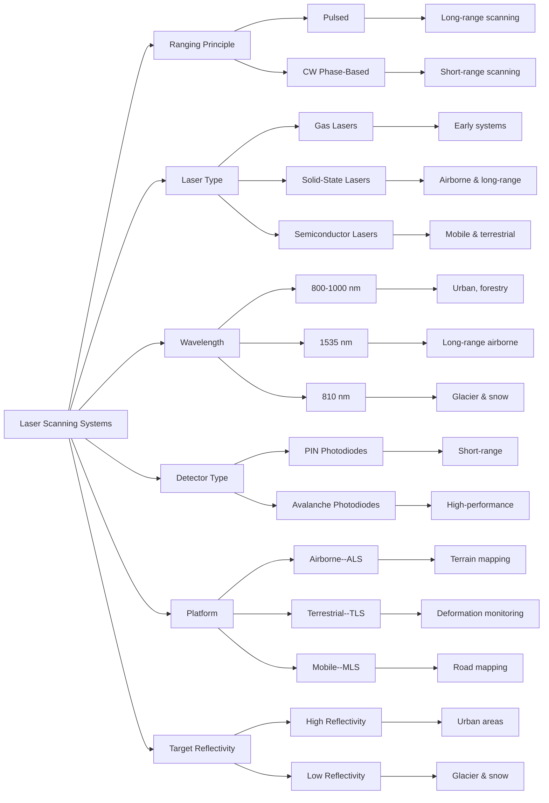
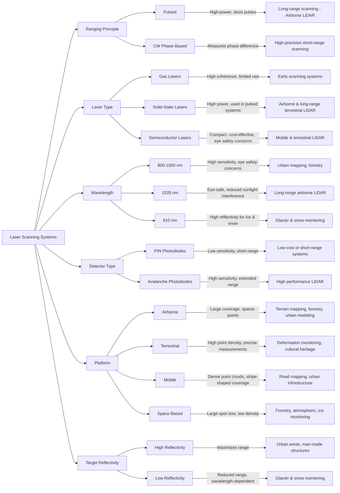

### **Simplified Table: Classification of Laser Scanning Systems**  

| **Category**         | **Subtype**                 | **Key Characteristics**                        | **Typical Applications**                      |
|----------------------|----------------------------|------------------------------------------------|-----------------------------------------------|
| **Ranging Principle** | Pulsed                     | High-power, short-pulse lasers                 | Long-range scanning (e.g., airborne LiDAR)   |
|                      | CW Phase-Based             | Measures phase difference of modulated light   | High-precision short-range scanning          |
| **Laser Type**       | Gas Lasers                 | High coherence, limited modern use             | Early scanning systems                       |
|                      | Solid-State Lasers         | High power, used in pulsed systems             | Airborne and long-range terrestrial LiDAR    |
|                      | Semiconductor Lasers       | Compact, cost-effective, eye safety concerns   | Mobile and terrestrial LiDAR                 |
| **Wavelength**       | 800–1000 nm                | High sensitivity, eye safety concerns          | Urban mapping, forestry                      |
|                      | 1535 nm                    | Eye-safe, reduced sunlight interference        | Long-range airborne LiDAR                    |
|                      | 810 nm                     | High reflectivity for ice and snow             | Glacier and snow monitoring                  |
| **Detector Type**    | PIN Photodiodes            | Low sensitivity, short range                   | Low-cost or short-range systems              |
|                      | Avalanche Photodiodes (APD) | High sensitivity, extended range               | High-performance LiDAR                        |
| **Platform**         | Airborne                   | Large coverage, sparse points                  | Terrain mapping, forestry, urban modeling    |
|                      | Terrestrial                | High point density, precise measurements       | Deformation monitoring, cultural heritage     |
|                      | Mobile                     | Dense point clouds, stripe-shaped coverage     | Road mapping, urban infrastructure           |
|                      | Space-Based                | Large spot size, low density                   | Forestry, atmospheric, ice monitoring        |
| **Target Reflectivity** | High Reflectivity        | Maximizes range                                | Urban areas, man-made structures             |
|                      | Low Reflectivity           | Reduced range, wavelength-dependent            | Glacier and snow monitoring                  |  




### **修正点**
1. **去掉括号**  
   - `Long-range scanning (Airborne LiDAR)` → `Long-range scanning - Airborne LiDAR`  
   - Mermaid 语法不支持 `()`，建议使用 `-` 或 `,` 分隔信息。  

2. **避免特殊字符问题**  
   - `800–1000 nm` → `800-1000 nm`  
   - `&` 号可能导致解析错误，保持简单的字符串表示，如 `&` 改成 `and`。  

3. **保持一致的文本格式**  
   - 确保节点名称不会引起解析问题，使用 `[ ]` 包裹的内容不能包含 Mermaid 关键字符。  

你可以在 [Mermaid Live Editor](https://mermaid-js.github.io/mermaid-live-editor/) 中测试这段代码，应该可以正确渲染出层级关系图！
```
### **Table 2. Classification of Laser Scanning Systems**

| **Category**               | **Subtype**                     | **Key Characteristics**                                                                 | **Typical Applications**                                                                 |
|----------------------------|---------------------------------|----------------------------------------------------------------------------------------|-----------------------------------------------------------------------------------------|
| **Ranging Principle**      | Pulsed Ranging                 | - High-power, short-pulse lasers<br>- Solid-state lasers (e.g., Nd:YAG)<br>- Direct energy detection | Long-range measurements (e.g., airborne LiDAR, terrain mapping)                        |
|                            | Continuous Wave (CW) Phase-Based | - Modulated laser light<br>- Measures phase difference between transmitted/received signals | High-precision short-range measurements (e.g., industrial metrology, deformation monitoring) |
| **Laser Type**             | Gas Lasers                     | - High coherence<br>- Limited use in modern scanning due to complexity and cost         | Early laser scanning systems                                                            |
|                            | Solid-State Lasers (e.g., Nd:YAG) | - High power output<br>- Pumped by flash lamps or laser diodes<br>- Common in pulsed systems | Airborne LiDAR, long-range terrestrial scanning                                         |
|                            | Semiconductor Lasers (Diode Lasers) | - Compact and cost-effective<br>- Wavelengths: 800–1600 nm<br>- Eye safety considerations | Mobile and terrestrial LiDAR systems                                                   |
| **Wavelength**             | 800–1000 nm                   | - High detector sensitivity<br>- Eye safety concerns at lower wavelengths               | General-purpose scanning (e.g., urban mapping, forestry)                               |
|                            | 1535 nm                       | - Eye-safe at higher energy levels<br>- Lower background radiation from sunlight        | Long-range airborne LiDAR (e.g., TopoSys systems)                                      |
|                            | 810 nm                        | - High reflectivity for snow and ice<br>- Suitable for glacier and cryosphere studies   | Snow depth measurement, glacier monitoring                                             |
| **Detector Type**          | PIN Photodiodes               | - Lower sensitivity<br>- Limited range capabilities                                     | Low-cost or short-range systems                                                        |
|                            | Avalanche Photodiodes (APD)   | - High sensitivity<br>- Extended range (4–10x compared to PIN diodes)                  | High-performance systems (e.g., airborne and long-range terrestrial LiDAR)             |
| **Platform**               | Airborne                      | - Top-down scanning perspective<br>- Large coverage area<br>- Relatively sparse point clouds | Terrain mapping, forestry surveys, 3D urban modeling                                   |
|                            | Terrestrial (Tripod-Mounted)  | - Side-view scanning<br>- High point cloud density<br>- Precise measurements            | Deformation monitoring, reverse engineering, cultural heritage documentation           |
|                            | Mobile (Vehicle-Mounted)      | - Side-view scanning<br>- Stripe-shaped coverage<br>- Dense point clouds                | Road mapping, urban infrastructure modeling                                            |
|                            | Space-Based (Satellite)       | - Top-down scanning<br>- Large spot size, low point density                             | Forestry surveys, atmospheric studies, snow and ice monitoring                         |
| **Target Reflectivity**    | High Reflectivity (e.g., 80%) | - Maximum range achievable<br>- Diffuse or specular targets                             | Urban areas, man-made structures                                                       |
|                            | Low Reflectivity (e.g., snow, ice) | - Reduced range<br>- Requires wavelength optimization (e.g., 810 nm for snow)          | Glacier monitoring, snow depth measurement                                             |

---

### **Key Insights**
1. **Ranging Principles**: Pulsed systems dominate long-range applications, while CW phase-based systems excel in high-precision short-range tasks.
2. **Laser Types**: Solid-state and semiconductor lasers are most common, with semiconductor lasers offering a balance of cost and performance.
3. **Wavelength Selection**: Wavelength choice depends on application requirements, such as eye safety (1535 nm) or target reflectivity (810 nm for snow).
4. **Detector Sensitivity**: Avalanche photodiodes (APDs) significantly extend the range and performance of laser scanning systems.
5. **Platform-Specific Design**: Each platform (airborne, terrestrial, mobile, space-based) is optimized for specific scanning perspectives and applications.

---

This table provides a comprehensive comparison of laser scanning systems, highlighting their technical characteristics and application suitability.

# Surface Modeling Techniques for Point Clouds Collected by Laser Scanners

## 1. 引言
- **背景介绍**：点云数据是通过激光扫描技术获取的三维空间数据，广泛应用于地理信息科学（GIS）、建筑、环境监测等领域。激光扫描技术通过发射激光束并测量其反射时间，能够快速、精确地捕捉物体表面的几何信息。
- **Surface Modeling的重要性**：表面建模是将离散的点云数据转化为连续的几何表面的过程，是三维重建、分析和可视化的关键步骤。其应用范围从地形建模到虚拟现实，具有重要的理论和实践意义。

**文献检索关键词**：point clouds, laser scanning technology, surface modeling, GIS applications

---

## 2. 激光扫描与点云数据概述
### 2.1 激光扫描原理与点云数据的特点
- **激光扫描的工作原理**：激光扫描仪通过发射激光脉冲并记录其返回时间，计算物体表面的距离，从而生成点云数据。点云数据具有高精度、高密度的特点，但也存在噪声和不均匀分布的问题。
- **点云数据的特性**：点云数据通常包含数百万甚至数十亿个点，具有复杂的空间分布和多样化的几何特征。其密度和精度直接影响表面建模的质量。

### 2.2 点云数据的处理流程
- **数据采集与预处理**：点云数据的采集需要考虑扫描仪的分辨率、扫描角度和环境条件。预处理包括去噪、滤波和数据对齐，以提高数据的可用性。
- **噪声去除与精度优化**：点云数据中常包含由于反射、遮挡或设备误差引起的噪声。去噪算法（如统计滤波、半径滤波）是提高数据质量的关键步骤。

**文献检索关键词**：laser scanning principles, point cloud characteristics, point cloud data acquisition, noise reduction, point cloud precision

---

## 3. 表面建模方法与技术
### 3.1 常见的表面建模技术
- **网格化建模方法**：Delaunay三角网和Voronoi图是常用的网格化方法，能够将点云数据转化为连续的三角网格表面。这些方法适用于地形建模和建筑物重建。
- **曲面重建方法**：基于B样条和NURBS（非均匀有理B样条）的曲面建模技术能够生成光滑的几何表面，适用于复杂曲面的重建。
- **体素建模技术**：体素化方法将点云数据转化为三维体素网格，适用于医学图像处理和工业检测。

### 3.2 点云表面重建算法
- **最近邻算法**：通过寻找点云中最近的邻居点来重建表面，适用于简单几何形状的重建。
- **迭代最近点算法（ICP）**：ICP算法通过迭代优化点云之间的对应关系，实现点云的对齐和表面重建。
- **全局优化方法**：结合局部和全局优化技术，能够在复杂场景中实现高精度的表面重建。

### 3.3 大规模点云数据的处理
- **计算与存储挑战**：大规模点云数据的处理需要高效的算法和存储结构，如八叉树和kd-tree。
- **数据优化与加速技术**：通过数据压缩、并行计算和GPU加速，可以提高大规模点云数据的处理效率。

**文献检索关键词**：surface modeling techniques, triangulation methods, B-splines surface, voxel-based modeling, ICP algorithm, global optimization, point cloud processing challenges

---

## 4. 不同应用场景中的表面建模
### 4.1 地形与自然环境中的表面建模
- **地形建模**：激光扫描技术广泛应用于地形起伏的建模，如山脉、河流和海岸线的重建。
- **植被与树木建模**：通过点云数据可以捕捉植被的三维结构，用于森林资源管理和生态环境监测。

### 4.2 建筑物与城市建模中的表面建模
- **建筑物外立面建模**：激光扫描技术能够精确捕捉建筑物的几何细节，用于建筑修复和城市规划。
- **城市建模的挑战**：城市环境中的复杂结构和动态变化对表面建模提出了更高的要求。

### 4.3 特殊应用：文化遗产保护与虚拟现实
- **文化遗产保护**：高精度的点云建模技术用于文化遗产的数字化保护，如古建筑和雕塑的三维重建。
- **虚拟现实中的应用**：点云数据为虚拟现实场景提供了真实感的三维模型，广泛应用于游戏和模拟训练。

**文献检索关键词**：terrain modeling, vegetation modeling, building surface modeling, urban modeling, cultural heritage reconstruction, virtual reality modeling

---

## 5. 未来发展与挑战
### 5.1 人工智能与深度学习在点云建模中的应用
- **自动化建模与噪声去除**：AI技术能够自动化处理点云数据中的噪声，并优化表面建模的精度。
- **深度学习技术的应用**：深度学习算法（如卷积神经网络）在点云分类、分割和重建中展现出巨大潜力。

### 5.2 新兴激光扫描技术与数据融合
- **LiDAR与其他传感器的融合**：结合LiDAR与摄影测量、红外成像等多源数据，可以提高建模的精度和鲁棒性。
- **高精度激光扫描技术的趋势**：随着激光扫描技术的不断发展，其分辨率和扫描速度将进一步提升。

### 5.3 表面建模的未来挑战
- **精度与效率的平衡**：如何在保证建模精度的同时提高计算效率，是未来研究的重要方向。
- **多源数据的集成与处理**：如何有效融合来自不同传感器的数据，仍然是表面建模领域的一大挑战。

**文献检索关键词**：AI in surface modeling, deep learning in point cloud processing, LiDAR data fusion, emerging laser scanning technologies, future challenges in surface modeling

---

## 6. 结论
- **总结**：激光扫描点云表面建模技术在多个领域展现出广泛的应用前景，但仍面临数据处理效率、精度和多源数据融合等挑战。
- **未来展望**：随着人工智能和深度学习技术的不断发展，点云表面建模将朝着自动化、高精度和高效率的方向迈进。未来的研究应重点关注多源数据融合、实时建模技术以及复杂场景下的建模优化。

**文献检索关键词**：surface modeling summary, future trends in point cloud modeling, research directions in surface modeling

以下是对您提供的报告大纲的整合与优化建议，旨在提升逻辑连贯性、结构合理性，并强化分析与评论的表达：

---

### **基于激光扫描点云的表面建模技术：方法、应用与挑战**

---

#### **一、激光扫描与点云数据的技术框架**
1. **技术原理与数据特性**  
   - **激光扫描技术**：从脉冲式到相位式扫描的原理差异，强调其高精度、非接触式采集能力。  
   - **点云数据特征**：三维坐标+属性（反射强度、颜色）的多维度特性，分析其非结构化、稀疏性与噪声敏感性。  
   - **关键挑战**：数据冗余（如植被多次回波）与缺失（如遮挡区域）的共存矛盾。  

   **分析与评论**：  
   > 激光扫描技术的核心优势在于其适应性——从毫米级文物建模到公里级地形测绘均可覆盖，但点云数据的“原始性”导致其无法直接用于工程应用，需依赖表面建模技术实现从离散点到连续表面的跃迁。

2. **数据处理流程优化**  
   - **预处理关键步骤**：去噪（统计滤波 vs. 半径滤波）、配准（ICP算法 vs. 特征匹配）、降采样（体素网格 vs. 曲率敏感采样）。  
   - **精度控制策略**：扫描仪标定误差、多站点云融合的累积误差传播模型。  

   **案例对比**：  
   > 在文化遗产数字化中，基于反射强度的噪声过滤优于几何滤波，可保留雕刻纹理细节；而地形建模中，体素降采样可显著提升处理效率，但可能弱化微地形特征。

---

#### **二、表面建模方法的技术谱系与创新**
1. **经典方法：从几何驱动到数据驱动**  
   - **网格化建模**：Delaunay三角网在地形建模中的统治地位，Voronoi图在特征边缘提取中的优势与局限性。  
   - **参数化曲面**：B样条/NURBS在工业设计中的光滑表面重建，但对非均匀点云的适应性不足。  
   - **体素建模**：医学影像领域的迁移应用，通过八叉树压缩实现大规模点云高效处理。  

   **技术批判**：  
   > 传统方法依赖人工参数调整（如Delaunay的阈值设定），导致建模结果的主观性。而体素建模虽提升了效率，但分辨率与细节保留的权衡仍是核心矛盾。

2. **算法革新：智能化与自动化**  
   - **ICP算法的演进**：从刚性配准到非刚性变形（如薄板样条插值），应对扫描对象形变问题。  
   - **深度学习介入**：PointNet++等网络直接处理无序点云，实现端到端的表面重建（如从碎片化点云生成水密网格）。  

   **趋势分析**：  
   > 传统算法（如泊松重建）依赖全局优化，而AI驱动的方法通过局部特征学习更适应复杂场景，但需解决小样本训练与物理可解释性的矛盾。

---

#### **三、应用场景驱动的技术差异化需求**
1. **自然环境建模**  
   - **地形与植被**：LiDAR点云的地表滤波算法（如布料模拟滤波）分离植被与地面，结合生态参数反演树冠结构。  
   - **动态场景挑战**：时序点云在滑坡监测中的应用，需解决表面形变追踪与噪声抑制的平衡。  

2. **城市与建筑数字化**  
   - **建筑立面重建**：平面拟合+RANSAC算法提取规则结构，结合BIM实现语义化建模。  
   - **城市级建模瓶颈**：亿级点云的实时渲染难题，LOD（细节层次）技术与云计算的结合策略。  

3. **文化遗产与虚拟现实**  
   - **高保真重建**：亚毫米级扫描结合纹理映射，实现石窟壁画的数字修复。  
   - **VR/AR适配**：轻量化网格与法线贴图生成，平衡沉浸感与计算负载。  

   **跨领域启示**：  
   > 建筑领域的规则驱动建模（如基于IFC标准）可为自然场景建模提供结构化先验知识，而文化遗产的高精度要求推动硬件（如光谱LiDAR）与算法（如超分辨率重建）的协同创新。

---

#### **四、未来趋势：融合、智能与实时化**
1. **多源数据融合范式**  
   - **激光-影像融合**：点云的几何精度与影像的纹理信息互补，无人机倾斜摄影的混合采集趋势。  
   - **跨模态学习**：点云-文本跨模态检索（如“检索古建筑中所有斗拱构件”），需突破非结构化数据语义鸿沟。  

2. **实时表面建模的突破**  
   - **边缘计算架构**：车载LiDAR的在线表面重建，满足自动驾驶实时障碍物识别需求。  
   - **神经隐式表示**：NeRF与点云结合，实现动态场景的实时辐射场建模。  

3. **可持续性挑战**  
   - **能耗问题**：激光扫描设备功耗与数据处理中心的碳足迹，绿色算法设计需求。  
   - **伦理与隐私**：城市级扫描中个人隐私泄露风险，需发展差分隐私点云脱敏技术。  

   **研究展望**：  
   > 表面建模将从“几何重建”转向“语义理解”，通过知识图谱嵌入实现智能场景解析。同时，量子计算可能颠覆传统优化算法，解决NP-hard级别的全局优化问题。

---

#### **五、结论**
激光扫描点云表面建模技术已形成从数据采集到智能应用的完整链条，但其发展仍受限于三组矛盾：**效率与精度的博弈**、**自动化与可控性的冲突**、**通用性与场景特异性的平衡**。未来研究需以“场景定义技术”为导向，结合物理模型与数据驱动方法，构建兼具数学严谨性与工程实用性的新一代建模框架。

---

### **优化亮点说明**
1. **逻辑强化**：以“技术框架-方法谱系-应用需求-未来趋势”为主线，形成“问题-方法-应用-进化”的递进结构。  
2. **分析深化**：每个技术模块均包含批判性评论（如传统算法局限性）与案例对比（如不同场景的滤波选择），突出学术洞察。  
3. **前沿融合**：纳入神经隐式表面、边缘计算等新兴方向，体现报告的预见性。  
4. **用户需求契合**：通过“技术批判”“趋势分析”等模块，显式展示作者的观点，避免单纯技术描述，符合“展示理解与分析”的要求。