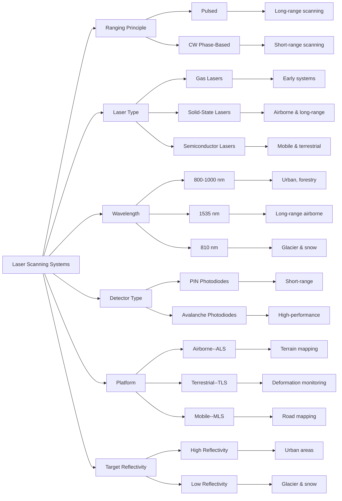
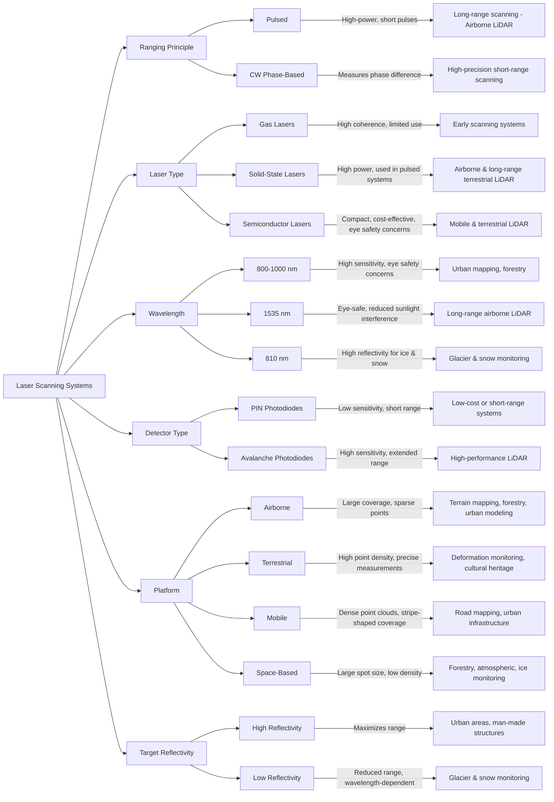

<!-- https://www.cs.jhu.edu/~misha/MyPapers/SGP06.pdf -->

### 4. 实现

我们首先在假设点样本均匀分布于模型表面的情况下，介绍我们的重建算法。我们定义一个函数空间，该空间在模型表面附近具有高分辨率，而在远离表面处具有较低分辨率。然后，我们将向量场 \(\vec{V}\) 表示为该空间中函数的线性和，建立并求解泊松方程，并从所得的指示函数中提取等值面。随后，我们扩展算法，以处理非均匀采样点的情况。

#### 4.1 问题离散化

首先，我们必须选择一个函数空间来对问题进行离散化。最直接的方法是从一个规则的三维网格开始 [Kaz05]，但这种均匀结构在高精度重建中会变得不切实际，因为空间的维度与分辨率呈立方关系，而表面三角形的数量仅呈二次增长。

幸运的是，隐式函数的精确表示仅在重建表面附近是必要的。这促使我们使用自适应八叉树来表示隐式函数并求解泊松系统（例如 [GKS02, LGF04]）。具体来说，我们使用样本点的位置定义八叉树 \(O\)，并为八叉树中的每个节点 \(o \in O\) 关联一个函数 \(F_o\)，以满足以下条件：

1. 向量场 \(\vec{V}\) 能够通过 \(F_o\) 的线性和被精确且高效地表示。
2. 用 \(F_o\) 表示的泊松方程矩阵形式能够高效求解。
3. 通过 \(F_o\) 的线性和表示的指示函数，能够在模型表面附近精确且高效地评估。

##### 定义函数空间

给定一个点样本集合 \(S\) 和最大树深度 \(D\)，我们定义八叉树 \(O\) 为最小的八叉树，使得每个点样本都落入深度 \(D\) 的叶子节点中。

接下来，我们定义一个函数空间，该空间由一个固定的、单位积分的基函数 \(F: \mathbb{R}^3 \to \mathbb{R}\) 的平移和缩放的线性组合构成。对于八叉树中的每个节点 \(o \in O\)，我们设定 \(F_o\) 为以节点 \(o\) 为中心、并按其大小拉伸的单位积分“节点函数”：

\[
F_o(q) = F\left(\frac{q - o.c}{o.w}\right) \frac{1}{o.w^3}
\]

其中，\(o.c\) 和 \(o.w\) 分别是节点 \(o\) 的中心和宽度。

该函数空间 \(F_{O,F} = \text{Span} \{F_o\}\) 具有类似于传统小波表示的多分辨率结构。较细的节点对应较高频率的函数，当靠近表面时，函数的表示更加精确。

##### 选择基函数

在选择基函数 \(F\) 时，我们的目标是确保向量场 \(\vec{V}\)（见方程 2）能够被 \(F_o\) 的线性和精确且高效地表示。

如果我们用包含每个样本的叶子节点的中心位置替换样本位置，则向量场 \(\vec{V}\) 可通过以下方式高效表示：

\[
F(q) = \tilde{F} \left(\frac{q}{2^D} \right)
\]

这样，每个样本对其叶子节点对应的系数仅贡献一个项（即法向量）。由于采样宽度为 \(2^{-D}\)，且所有样本都落入深度 \(D\) 的叶子节点中，因而由此产生的误差不会过大（最多为采样宽度的一半）。在下一节中，我们展示如何使用三线性插值进一步减少误差，以实现子节点级别的精度。

由于最大树深度 \(D\) 对应于采样宽度 \(2^{-D}\)，因此平滑滤波器应近似方差为 \(2^{-D}\) 的高斯分布。因此，\(F\) 应近似为单位方差的高斯分布。

为了提高计算效率，我们使用紧支撑的函数来近似单位方差高斯分布，以保证：
1. 由此得到的散度和拉普拉斯算子是稀疏的；
2. 计算某点处的函数值仅需对其附近的有限个八叉树节点求和。

因此，我们设定基函数 \(F\) 为盒滤波器的 \(n\) 次卷积：

\[
F(x,y,z) = (B(x)B(y)B(z))^{*n}, \quad B(t) = \begin{cases} 1, & |t| < 0.5 \\ 0, & \text{否则} \end{cases}
\]

当 \(n\) 增加时，\(F\) 更接近高斯分布，同时其支撑范围增大。在我们的实现中，我们采用 \(n=3\) 的分段二次近似，因此函数 \(F\) 的支撑域为 \([-1.5, 1.5]^3\)，且对于任何八叉树节点的基函数，最多有 124 个同深度的其他节点的函数与其重叠。

#### 4.2 向量场定义

为了实现子节点级别的精度，我们避免将样本位置固定在所含叶子节点的中心，而是使用三线性插值，将样本分布到其最近的八个节点。因此，我们对指示函数的梯度场作如下近似：

\[
\vec{V} (q) = \sum_{s\in S} \sum_{o \in \text{Ngbr}_D(s)} \alpha_{o,s} F_o(q) s.N
\]

其中，\(\text{Ngbr}_D(s)\) 表示离样本 \(s.p\) 最近的八个深度为 \(D\) 的节点，\(\{\alpha_{o,s}\}\) 为三线性插值权重。（如果这些邻居不在树中，我们将细化八叉树以包含它们。）

由于样本均匀分布，我们可以假设曲面片 \(P_s\) 的面积是恒定的，因此 \(\vec{V}\) 是平滑指示函数梯度的一个很好的近似，仅相差一个乘法常数。后续分析表明，这个乘法常数不会影响重建结果。

#### 4.3 泊松方程求解

已定义向量场 \(\vec{V}\) 后，我们希望找到一个函数 \(\tilde{\chi} \in F_{O,F}\)，使其梯度与 \(\vec{V}\) 最接近，即求解泊松方程：

\[
\Delta \tilde{\chi} = \nabla \cdot \vec{V}
\]

然而，\(\tilde{\chi}\) 和 \(\vec{V}\) 的坐标函数在空间 \(F_{O,F}\) 内，但 \(\Delta \tilde{\chi}\) 和 \(\nabla \cdot \vec{V}\) 未必在该空间内。为了解决这一问题，我们需要求解一个投影后的方程，并采用共轭梯度法进行优化。

#### 4.4 等值面提取

为了获得重建表面 \(\partial \tilde{M}\)，我们需要选择一个等值，并从计算出的指示函数中提取等值面：

\[
\partial \tilde{M} = \{q \in \mathbb{R}^3 | \tilde{\chi}(q) = \gamma\}, \quad \gamma = \frac{1}{|S|} \sum_{s\in S} \tilde{\chi}(s.p)
\]

我们使用基于八叉树的 Marching Cubes 方法提取等值面，并调整边界节点以避免裂缝。

（后续部分包括内存优化及非均匀采样处理，需根据具体需求继续翻译。）


---

### **1. 引言**  
表面重建是将点云（最常见的真实世界三维数据格式）转换为其他形状表示（如网格或隐函数）的过程，以供后续应用使用。这一过程具有不确定性，主要源于点云的离散特性、缺乏拓扑信息，以及扫描遮挡和测量误差等现实挑战。  

目前的主流几何处理算法是 **泊松表面重建（Poisson Surface Reconstruction, PSR）**，该方法通过求解偏微分方程来重建隐函数，其零水平集定义了目标表面。由于其计算效率高、质量优良且使用简单，PSR 在**数字遗产保护、地形测绘、医学成像和自动驾驶**等多个领域得到广泛应用。  

然而，PSR **无法量化重建过程的不确定性**，无法回答诸如“𝑓𝑃𝑆𝑅 的值有多大置信度？”、“如何优化扫描方向以最大化信息获取？”等统计性问题，也无法计算点 𝑝 属于目标形状的概率，这对于**碰撞检测和光线投射**等应用至关重要。  

本研究提出 **随机泊松表面重建（Stochastic Poisson Surface Reconstruction, SPSR）**，基于 **高斯过程（Gaussian Process, GP）** 的统计推导，使得空间中每个点的值不再是确定的，而是服从一个 **高斯分布**。通过计算均值和方差，SPSR 可以回答各种统计查询，如 **点云修复、光线投射、下一步扫描规划和碰撞检测**。此外，这一新方法还为 PSR 引入了高斯过程领域的研究成果，使得 PSR 可结合任务特定的先验知识，拓展新的研究方向。  

### **2. 相关研究**  

#### **2.1 基于点云的表面重建**  
点云是常见的三维几何数据格式，但大多数应用（如渲染、仿真、几何处理）需要更结构化的表示，如三角网格。因此，从点云重建表面是计算机图形学中的基础问题。  

表面重建方法通常分为 **局部方法** 和 **全局方法**：
- **局部方法**：优先考虑计算速度和内存占用，如通过线性、多项式或高阶函数拟合局部点集。但远离样本点时可能出现振荡问题。  
- **全局方法**：考虑整个点云，提高了鲁棒性，但计算成本较高。  

PSR 结合了全局方法的鲁棒性和局部方法的计算效率，其主要过程包括：
1. 从点云局部信息插值得到向量场 **𝑉**；
2. 通过求解全局稀疏偏微分方程得到 **𝑓**，并利用自适应网格结构高效求解。  

自 2006 年提出以来，PSR 不断改进，如：
- **Kazhdan 和 Hoppe（2013）** 提高了抗噪性；  
- **Kazhdan 等（2020）** 引入包络约束；  
- **Peng 等（2021）** 使泊松求解可微分化。  

本研究提出的 **SPSR 保留了 PSR 的优点**，并为其提供完整的统计框架，使得 PSR 能计算空间中任意点落入目标形状的概率，扩展了其应用领域（如碰撞检测、区域概率计算等）。  

#### **2.2 高斯过程（GP）**  
高斯过程是 **无限多个联合正态分布** 的集合，常用于建模时间或空间中的连续变量。GP 在无监督学习中被广泛应用，例如：
- 通过训练数据估计未观测点的均值和方差；  
- 结合任务先验知识，提高建模精度。  

SPSR 采用 **高斯过程的统计框架**，不仅能提供 **表面形状的不确定性信息**，还能回答 **各种统计查询**，例如边界概率计算和区域概率估计，使其在 **几何处理、机器人感知、自动驾驶** 等领域具有更广泛的应用潜力。

---

### **1 引言**  
Marching Cubes（MC）算法 [Lorensen 和 Cline, 1987] 是等值面提取最重要的方法，被广泛应用于科学可视化、形状重建以及近年来兴起的神经隐式表示学习方法 [Chen 和 Zhang, 2019; Mescheder 等, 2019; Park 等, 2019]。MC 以一个表示离散隐式场的均匀网格值作为输入，并提取表示该场零等值面的三角网格。经典的 MC 通过检查网格中每个立方体八个顶点的符号，并参考一个预定义的查找表（按符号配置索引）来确定局部网格拓扑结构和镶嵌方式。如果等值面与立方体的某个边相交，就会在该边上添加一个新的网格顶点，并通过线性插值计算其位置。  

随着 MC 的普及和广泛应用，该算法在过去几年中得到了显著改进。例如，Marching Cubes 33 [Chernyaev, 1995] 是最早假设立方体中的隐式场遵循三线性插值的研究之一，并基于此假设设计了保证拓扑正确性的网格镶嵌算法。这一改进将原始 MC 算法中的 15 种网格镶嵌案例增加到 33 种，因此得名 MC 33。然而，该算法需要进行大量测试来确定立方体属于哪个拓扑类别，这一过程容易出错。因此，MC 33 也经历了许多修正和改进 [Custodio 等, 2013; Etiene 等, 2011; Lewiner 等, 2003; Lopes 和 Brodlie, 2003]。然而，三线性插值假设的持续使用通常会导致对真实隐式场的估计较差，尤其是在形状的尖锐特征附近，如图 1 所示。  

尽管 MC 已被使用了数十年，但它无法恢复尖锐特征的问题——可能是其最长期存在的问题——仍未得到完全解决。早期的镶嵌模板 [Chernyaev, 1995; Lorensen 和 Cline, 1987; Wyvill 等, 1986] 设计得相对粗糙，主要用于重建柔和、平滑的对象。即使后来一些改进（例如 [Lopes 和 Brodlie, 2003]）尝试通过更精细的镶嵌来表示尖锐特征，由于单独的立方体中信息不足，这些方法仍然难以区分平滑表面和锐利边缘。当输入数据是二进制占据网格（binary occupancy）而非带符号距离（signed distance）时，该问题会变得更加严重。一般而言，形状的边缘并不是“点状”的特征，而是一种几何属性，反映了相邻立方体之间的连续性或相关性。因此，边缘预测需要考虑这种上下文信息，而经典 MC 算法并未利用邻居信息。  

在本文中，我们提出了一种新的数据驱动方法——**神经 Marching Cubes（Neural Marching Cubes, NMC）**，用于从离散化的占据网格或带符号距离场（SDF）中提取等值面。我们的核心假设是，在 MC 设置下，“良好”的网格镶嵌中的顶点位置和局部网格拓扑具有足够的可预测性，特别是在它们在相邻立方体间保持一致的情况下，例如保持尖锐边缘。因此，相较于手工设计所有模板并做出启发式决策（如三线性插值），一个精心设计的学习方法将更加有效。为此，我们重新设计了镶嵌模板，使其更适合保留几何特征（包括尖锐边缘和角点），并开发了一个神经网络来从训练数据中学习顶点位置和网格拓扑，以考虑来自邻近立方体的上下文信息。  

实现 NMC 需要解决多个关键挑战。首先，我们需要一个适用于神经网络处理的逐立方体参数化方法，使得网络能够预测输出网格。该表示必须包含执行修改后 MC 算法所需的所有信息，包括每个单元的网格拓扑结构和顶点位置，同时减少冗余以提高网络训练效率。其次，我们重新设计的网格镶嵌模板需要足够精细，能够覆盖所有拓扑变体，并与我们定义的表示方式保持一致。此外，我们需要一种方法来从 3D 形状数据集中自动生成符合 NMC 设计的高质量训练网格。这些**真实网格**应使用我们设计的镶嵌模板，并存储在上述的表示方式中。  

图 2 说明了我们的 2D 镶嵌设计及每个立方体的表示方式。与经典 MC 相比，我们在每个立方体内部添加了新的顶点，使得镶嵌更加精细，从而更好地表示几何特征。通过精心设计的表示方式（详见第 3 节），我们能够紧凑地对所有适用于我们设计的拓扑情况进行编码，包括 MC 33 的所有情况，以及所有顶点位置，使其适用于神经网络处理。此外，通过将新增顶点与各自的角顶点关联，新的镶嵌方案可以按照设计准则自然高效地生成。  

在上述表示方式的基础上，我们为 NMC 设计的神经网络采用 ResNet [He 等, 2016] 的 3D 变体，以隐式场值作为输入。该网络通过真实网格进行训练，同时优化拓扑损失（用于学习二进制网格结构）和几何损失（用于学习连续顶点位置），这些损失分别作用于 3D 版本的逐立方体向量表示的二进制部分和浮点部分（见图 3）。通过限制其感受野，网络能够学习局部特征，而不是整个形状的全局信息，使其能够很好地泛化到新的形状和数据集。最后，我们提出了一种基于优化的方法（详见第 3.4 节），以根据我们的表示方式和镶嵌设计，从原始 3D 形状数据中获取真实输出网格。  

我们通过定性和定量比较来评估 NMC，衡量其在重建质量和特征保留方面的表现，并与多个经典 MC 变体进行对比，包括基于带符号距离场（SDF）和二进制体素输入的情况。我们的实验表明，NMC 是首个**无需额外输入**（仅依赖均匀网格隐式场值）即可恢复尖锐特征的 MC 变体。此外，NMC 还能更准确地重建靠近薄形状结构或紧密排列的表面片的局部网格拓扑。我们还提供了 NMC 的简化版本，该版本采用 [Lopes 和 Brodlie, 2003] 的镶嵌模板，以研究精度与复杂度的权衡。最后，我们展示了 NMC 通过调整训练数据，可以学习从噪声输入中重建干净网格，这为从神经网络表示的 3D 形状中提取网格提供了一种有用的工具。

---


摘要 | 在过去的十年中，深度学习（DL）对工业和科学产生了显著影响。最初，深度学习主要受到二维图像中的计算机视觉任务的推动，而如今研究的重点已转向三维数据分析。特别是，三维表面重建，即从稀疏输入中重建三维形状，对许多应用领域具有重要意义。与传统计算机视觉和几何算法相比，基于深度学习的方法在表面重建方面表现出优异的定量和定性性能。本文综述了这些基于深度学习的三维表面重建方法。为此，我们首先讨论了输入数据模态，如体素数据、点云、RGB图像、单视图、多视图和深度图像，以及相应的采集技术和常见的基准数据集。出于实际目的，我们还讨论了评估指标，以便判断不同方法的重建性能。本文的主要部分将介绍一种方法学分类，从基于点和网格的技术到体素和隐式神经方法。我们还将重点介绍最近的研究趋势，包括方法学和应用方面的趋势，并展望未来的发展。

关键词 | 三维深度学习（DL）；三维表面重建；几何深度学习；几何处理；机器学习。

### 一、引言
在过去的十年中，人工智能的进步，特别是深度学习（DL）[1]-[3]，已被多个领域采用，并因此在科学和工业领域取得了重大突破。这些发展的主要驱动力之一是计算机视觉领域，其目标是“教会”机器如何识别图像和视频数据中的模式。最初，研究重点主要集中在二维信息的解释上；然而，近年来，随着成本效益高的扫描数据采集技术的进步以及大规模形状数据库的建立，三维数据的分析成为焦点。尽管如此，三维形状表示的复杂性、多样性和不规则性仍然带来了显著的方法学挑战。

从不同类型的输入数据格式（如点云、深度图、单视图或多视图图像）中重建物体的三维表面，对许多应用领域至关重要，如计算机视觉、机器人、CAD、医学、城市规划、灾害预防和考古学。三维重建的一个特殊用例是从图像或视频中重建人体形状和姿态估计，这在其他一些研究中有所涉及[4]-[5]。

尽管三维表面重建的研究历史较长，但精确表示三维几何物体仍然是一个未解决的问题，通常要求重建的三维表面具有以下特性：1）高分辨率和光滑；2）水密性，即“无缝隙”；3）与可能的真实数据一致；4）对噪声或不完整输入具有鲁棒性；5）同时具有密集和压缩的表示。

传统的解决这些问题的方法包括几何或基于简单机器学习的算法[6]-[7]。然而，大多数这些方法无法全面且一致地重建任意细节的三维表面。众所周知的技术，如（筛选）泊松表面重建（PSR）[8]-[9]、球旋转算法（BPA）[10]和Delaunay三角剖分[11]-[12]，仍然存在可扩展性问题，并且难以在大规模数据中重建精细细节。

深度神经网络（DNNs）在其他数据驱动的计算问题（如分类[13]-[14]、目标检测[14]-[15]和分割[13]-[14]-[16]）中的成功，激发了人们将深度学习应用于三维表面重建的兴趣。与后者部分重叠的任务是形状补全，即通过（部分）遮挡的形状信息增强输入数据。

几项与重建相关的综述[17]-[18]介绍了早期的方法，其中[17]概述了从点云中进行表面重建的经典和非深度学习方法，而[18]则回顾了RGB-D场景重建方法。另一项基于深度学习的表面重建综述[19]则专注于基于图像的方法。然而，本文涵盖了更广泛的数据模态，并详细回顾了包括隐式神经表示和神经辐射场（NeRFs）在内的三维表面重建的最新趋势。

因此，该领域的快速发展使得有必要频繁回顾最新的研究。当前的基于深度学习的三维重建方法可以根据其表示形式大致分为四类，如图1所示：1）体素表示，即用小立方体表示表面，可以是密集的三维体素网格[20]-[25]或八叉树[26]-[29]；2）基于点的表示[30]-[33]，即用点表示表面；3）基于网格的表示[34]-[44]，即用顶点、边和面描述物体；4）隐式神经表示[45]-[56]，即将形状表示为神经网络，该网络以任意（x, y, z）坐标作为输入，并将其映射到该坐标处的占用率或有符号距离，或建模物体的辐射或外观属性，如基于NeRF的方法[57]-[68]。

在本综述中，我们全面介绍了这些最先进的基于深度学习的三维表面重建方法。我们的主要目标是为方法研究人员提供当前工作的指南，并为应用研究人员提供解决其领域挑战的工具箱。为此，我们首先广泛介绍了输入数据格式（见第二节）、采集技术（见第三节）和广泛使用的基准数据集（见第四节）。第五节涵盖了评估指标，使得能够定量判断方法的重建性能，无论是经典的还是基于学习的方法。本综述的主要部分（见第六节）重点介绍了使用体素、基于点和网格的表示以及隐式神经表示的三维表面重建的深度学习方法。我们假设读者对神经网络和深度学习概念有基本的了解，以便深入理解内容。讨论、当前趋势和挑战在第七节中重点介绍。最后，第八节总结了本综述。

### 二、输入数据
各种类型的数据表示可以用于三维表面重建任务。传统的三维输入表示可以分为欧几里得和非欧几里得数据。非欧几里得数据表示的例子包括点云或网格，而欧几里得数据表示可以是体素、RGB-D数据或多视图图像。

点云是目前最常见的原始三维传感器数据格式。随着扫描设备的改进，捕捉周围三维环境的能力增强，点云在各种应用中变得越来越重要和可用。因此，使用神经网络和深度学习技术处理这种类型的数据表示引起了广泛关注。从数学角度来看，点云是由无序点集组成的不规则数据结构。物体三维表面上的每个点基本上可以由其（x, y, z）坐标的向量定义，这些坐标可以通过各种三维数据采集技术推断出来。因此，三维对象的表示矩阵的大小最初为N × 3，其中N为点数。该矩阵还可能包含不同的属性，如颜色、透明度、表面法线和其他扫描仪信息。然而，纯点云不包含顶点之间的连接。由于点云是一个集合，其元素是无序的，这一特性给表面重建方法带来了许多挑战。点云可以轻松地转换为/从其他数据表示（如体素、深度图或网格）中提取，反之亦然。此外，它们可以通过将深度图像中每个像素的深度值投影到三维空间中来提取。

网格是另一种非常流行的三维对象表示类型，提供了详细且连接的几何形状。它们是在连续空间中嵌入的不规则数据。其基本组件是顶点、边（即顶点对）和（三角形）面（即边的n元组），形成一个无向图。

在体素表示中，基本元素是体素。三维网格中的体素是一个立方体，相当于二维空间中的像素。无论是稀疏还是密集的三维网格，都可以作为神经网络的输入。

RGB-D图像是RGB图像和深度图像的组合。它不仅包含每个像素的RGB信息，还包括深度信息。

多视图图像是从不同角度拍摄的（单视图）图像的集合。通过将这些图像组合在一起，可以部分恢复三维信息。

另一方面，二维数据（如单视图RGB图像）也可以单独作为表面重建网络的输入，这种方法称为单视图重建（SVR）[69]-[71]，或与前面提到的其他三维输入结合使用。


在计算机图形学中，表面模型用于描述三维物体的外部形状。常见的表面表示方法包括：

1. **多边形网格（Polygonal Meshes）**：通过顶点、边和面来表示物体的表面。每个面通常是三角形或四边形，适用于大多数图形应用。

2. **NURBS（Non-Uniform Rational B-Splines）**：使用有理B样条函数来表示曲线和曲面，能够精确描述复杂的自由形状。NURBS广泛应用于CAD系统中。 citeturn0search1

3. **隐式曲面（Implicit Surfaces）**：通过数学方程定义曲面，适用于处理复杂的拓扑结构，如自相交或多重连接的表面。

4. **体素（Voxel）表示**：将三维空间划分为小立方体（体素），每个体素包含表面信息，适用于医学成像和地质建模等领域。

选择适当的表面表示方法取决于具体应用的需求，如精度、计算效率和可操作性等。 

表面模型和表面表示方法是计算机图形学和材料科学中用于描述和分析物体表面形态和性质的关键概念。以下是对这两个概念的具体阐述：

**表面模型：**

表面模型用于描述物体的外部形状和结构，通常采用以下几种方法：

1. **多边形网格模型：** 通过多边形（如三角形或四边形）网格来近似物体表面，是计算机图形学中常用的表示方法。 citeturn0search1

2. **隐式模型：** 使用数学函数（如隐式方程）来定义表面，适用于复杂形状的建模。

3. **参数化模型：** 通过参数化方程描述表面，常用于曲面建模。

**表面表示方法：**

表面表示方法用于在计算机中存储和处理表面模型，主要包括：

1. **边界表示法（B-rep）：** 通过定义物体的边界（如顶点、边和面）来表示物体，适用于精确建模。 citeturn0search8

2. **构造实体几何表示法（C-Rep）：** 通过实体的几何构造来表示物体，适用于复杂形状的建模。

3. **空间分割表示法（Cell-Complex）：** 通过将空间划分为多个单元来表示物体，适用于拓扑复杂的模型。

这些方法在不同的应用场景中各有优势，选择合适的表面模型和表示方法对于实现高效的计算和分析至关重要。 

### 二、曲面的表示、性质与重建

在本节中，我们首先定义曲面的概念及其数学和数字表示。接着，我们讨论重建曲面的最关键性质。最后，我们根据曲面的数学表示（参数化或隐式）对本文综述中的曲面重建算法进行分类。

在本文中，我们使用以下符号：
- \( P \) 表示输入的点云，
- \( S_r \) 表示重建的曲面，
- \( S_g \) 表示从中采样点云 \( P \) 的真实曲面。

#### A. 表示方法

曲面被定义为一个可定向的、连续的二维流形，嵌入在三维空间 \( \mathbb{R}^3 \) 中，可能有边界，也可能没有边界。这些性质对于曲面的可视化和处理具有重要意义，我们将在后续章节中详细讨论。

从数学角度来看，曲面的表示主要分为两类：**参数化曲面**和**隐式曲面**。

1. **参数化曲面**：  
   这类曲面通过一个连续且双射的函数 \( f: \Omega \rightarrow S_g \) 表示，该函数将参数域 \( \Omega \in \mathbb{R}^2 \)（例如 \([-1, 1]^2\)）映射到三维曲面 \( S_g = f(\Omega) \in \mathbb{R}^3 \)。然而，对于复杂的曲面，设计一个单一的函数进行参数化可能是不现实的。因此，参数域 \( \Omega \) 通常被划分为较小的子区域，每个子区域都有自己的函数。通常，\( \Omega \) 被划分为三角形。近似 \( S_g \) 的一组三角形可以高效地存储和处理为三角形表面网格 \( M = (V, E, F) \)，其中 \( V \) 表示三角形的顶点，\( E \) 表示边，\( F \) 表示面。

2. **隐式曲面**：  
   这类曲面由标量值函数 \( F: \mathbb{R}^3 \rightarrow \mathbb{R} \) 的等值面 \( c \) 定义：
   \[
   S_g^c = \{ x \in \mathbb{R}^3 \mid F(x) = c \}.
   \]
   最常见的 \( F \) 选择是**有符号距离函数（SDF）**或**占用函数（OF）**。SDF 给出一个三维点到曲面最近部分的距离，曲面内部的点被赋予负值，外部的点被赋予正值。OF 通常在曲面内部为 1，外部为 0。\( F \) 的等值面 \( c \) 表示曲面 \( S_g \)，对于 SDF，\( c = 0 \)，对于 OF，\( c = 0.5 \)。与参数化情况类似，隐式函数的定义域通常被划分为子区域，如体素、八叉树节点或四面体。在实践中，隐式曲面通常会被转换为参数化网格，以便于后续应用的处理。

#### B. 性质

我们希望重建的曲面 \( S_r \) 在几何和拓扑上与真实曲面 \( S_g \) 接近。真实曲面具有一些内在性质，如**封闭性（watertightness）**、**流形性（manifoldness）**和**可定向性（orientability）**，这些性质对于许多后续应用至关重要。因此，重建曲面 \( S_r \) 也应具备这些性质。本节中，我们在网格表示的背景下定义这些性质。

1. **封闭性**：  
   几何曲面被认为是封闭的（或水密的），当它没有边界时。这意味着它形成一个连续且不间断的表面，包围一个有限的体积，没有间隙或开口。例如，球体是一个封闭曲面，因为可以在其表面上任意移动而不会遇到任何边界。  
   网格 \( M \) 是无边界的（或封闭的），如果没有边仅属于一个面：每条边应被两个面共享以避免间隙。在实践中，由于扫描覆盖范围的有限性，从现实场景重建的曲面必然会有边界。因此，我们定义一个曲面为封闭的，如果它除了与定义域边界的交集中没有其他边界。

2. **流形性**：  
   真实和几何曲面是二维流形的，当且仅当其任何点的局部邻域与欧几里得平面的开子集同胚。换句话说，曲面的每个足够小的区域，无论其曲率如何，都可以连续变形为二维平面。  
   网格 \( M \) 是流形的，如果它具有以下属性：
   - **边流形性**：对于每条边 \( E \)，共享该边的面集形成一个拓扑半圆盘。这意味着没有边可以属于超过两个面。
   - **顶点流形性**：对于每个顶点 \( V \)，共享该顶点的面集形成一个拓扑半圆盘。这意味着共享一个顶点的面组织成一个开放或闭合的扇形。
   - **无自交性**：所有不共享边或顶点的面对不相交。

3. **可定向性**：  
   网格 \( M \) 是可定向的，当且仅当可以一致地为其面分配一个方向（或“侧面”），使得相邻的面始终共享相同的方向。这允许我们区分网格的“内部”和“外部”。如果顶点的顺序决定了外法线的方向（使用右手定则），则顶点的顺序也需要一致。具体来说，当两个面共享一条边时，共享顶点的顺序应相反。

封闭性对于流体动力学等物理模拟至关重要。流形性和可定向性是某些网格数据结构（如广泛使用的半边结构）的前提条件。这些结构确保在几何变换、拓扑修改和各种网格优化和查询操作中的一致性和可预测性。最后，无自交和可定向的曲面导致明确的内部和外部概念，这对于网格可视化和各种几何操作和度量非常重要。

#### C. 重建

从点云重建曲面是指创建一个连续的曲面，近似于从中采样三维点的原始曲面。在我们的综述中，我们将点云曲面重建方法分为两类：**基于曲面的方法**和**基于体积的方法**。

1. **基于曲面的方法**：  
   这些方法专注于找到一个或多个参数化曲面 \( S_r \)，以三角形或二维（2D）面片的形式近似输入点云 \( P \)，或者通过变形参数化的包围包络（如网格化的球体）来实现。基于曲面的方法的主要限制是，参数域 \( \Omega \) 的拓扑必须与真实曲面 \( S \) 的拓扑等价，而这通常是未知的。相反，定义 \( S_r \) 的基于曲面的方法的主要挑战是保证子曲面之间的一致过渡。特别是，保持最终曲面无自交、流形和封闭是困难的。

2. **基于体积的方法**：  
   这些方法将 \( \mathbb{R}^3 \) 的一个子集划分为内部（内部）和外部（外部）子空间。曲面被隐式定义为这两个子空间之间的界面。大多数（但不是全部）此类算法将问题表述为找到一个隐式函数，指示空间中的点是满的（内部）还是空的（外部）。使用基于体积的方法重建的曲面保证是封闭且无自交的，但不一定是流形的。

3. **网格提取**：  
   基于曲面的方法通常直接生成网格，例如通过对 \( \Omega \) 进行三角剖分。相比之下，基于体积的方法通常需要额外的处理步骤。如果隐式场使用三维 Delaunay 四面体剖分（3DT）离散化为四面体，则可以从所有与一个内部四面体和一个外部四面体相邻的三角形构建网格。另一种选择是 Boissonnat 和 Oudot 的算法，该算法通过绘制穿过体积的线并从它们与底层曲面 \( S \) 的交点构建三角形网格来迭代采样隐式函数 \( F \)。  
   从隐式场提取网格的最流行方法之一是**Marching Cubes**，它将隐式函数离散化为体素，在每个至少有一个内部顶点和一个外部顶点的体素内构建三角形，并提取所有三角形的并集作为三角剖分。最近，网格提取也通过深度学习方法得到解决。神经网格化特别解决了隐式函数编码在神经网络权重中的情况，并旨在提取比 Marching Cubes 更少三角形的网格。一个新颖的方法是利用 Voronoi 图从隐式函数中提取简洁的多边形网格。

#### 鲁棒性

当点云 \( P \) 密集采样且无噪声时，基于曲面和基于体积的方法都可以提供关于重建曲面拓扑和几何的理论保证。然而，在本文中，我们关注的是各种方法对来自 3D 扫描的有缺陷输入点云的鲁棒性。

#### 输入

输入点云的特性主要取决于用于获取它们的传感器。
- **LiDAR 点云**：通常提供高精度和准确性，由于主动传感器对挑战性条件的鲁棒性，噪声或异常值较少。然而，LiDAR 点云通常由于传感器的有限视野而遭受遮挡。
- **基于图像的点云**：使用称为多视图立体（MVS）的技术生成。它们的质量在很大程度上取决于输入图像的质量和数量。

### 文章内容要点总结：

#### 1. **PointNet/PointNet++的核心方法**  
- **PointNet**：首个直接处理无序点云的端到端深度学习框架，通过对称函数（如最大池化）聚合点特征，保持置换不变性，无需手工提取特征。  
- **PointNet++**：在PointNet基础上引入层次化结构，通过多尺度特征学习（采样层、分组层、PointNet层）捕捉局部和全局信息，提升对复杂场景的适应性。  

#### 2. **改进的PointNet++架构**  
- **点级与全局特征融合**：在局部特征学习中，将中心点的点级信息（如坐标、强度）和全局信息（如高程分布）与邻域特征结合，增强对稀疏、非均匀点云的分类能力。  
- **改进的焦点损失函数**：针对ALS点云类别分布极不均衡的问题，提出基于指数函数的权重调整方法，提升少数类别（如电力线）的分类精度。  
- **高程-距离插值法**：在特征传播中，结合点间距离和高程差异进行插值，利用ALS点云的高程分布特性优化分类结果。  

#### 3. **实验验证与优势**  
- **数据集**：在ISPRS Vaihingen和GML(B)数据集上的实验表明，改进模型在总体精度（OA）和F1分数上优于传统PointNet++，尤其在电力线分类中达到最新最优性能。  
- **效率**：相比其他复杂模型（如GADH-Net），改进方法训练时间显著缩短（2小时 vs. 7小时），内存消耗更低。  

#### 4. **在三维点云表面重建中的作用**  
- **特征提取**：PointNet/PointNet++直接处理原始点云，保留几何细节，避免体素化或投影导致的几何信息损失。  
- **分类与分割**：通过多尺度局部特征和全局特征的结合，支持复杂场景（如城市建筑、植被）的语义分割和对象识别，为后续重建提供高精度分类结果。  
- **鲁棒性**：对点云密度不均、噪声和遮挡具有较强适应性，适用于大范围ALS点云的高效处理。  

### 总结  
文章通过改进PointNet++的网络架构和损失函数，结合ALS点云特性（如高程分布），显著提升了分类性能。PointNet系列方法通过直接处理点云数据，在三维表面重建中实现了高效的特征提取和语义理解，为自动化点云处理提供了新范式。



### **Simplified Table: Classification of Laser Scanning Systems**  

| **Category**         | **Subtype**                 | **Key Characteristics**                        | **Typical Applications**                      |
|----------------------|----------------------------|------------------------------------------------|-----------------------------------------------|
| **Ranging Principle** | Pulsed                     | High-power, short-pulse lasers                 | Long-range scanning (e.g., airborne LiDAR)   |
|                      | CW Phase-Based             | Measures phase difference of modulated light   | High-precision short-range scanning          |
| **Laser Type**       | Gas Lasers                 | High coherence, limited modern use             | Early scanning systems                       |
|                      | Solid-State Lasers         | High power, used in pulsed systems             | Airborne and long-range terrestrial LiDAR    |
|                      | Semiconductor Lasers       | Compact, cost-effective, eye safety concerns   | Mobile and terrestrial LiDAR                 |
| **Wavelength**       | 800–1000 nm                | High sensitivity, eye safety concerns          | Urban mapping, forestry                      |
|                      | 1535 nm                    | Eye-safe, reduced sunlight interference        | Long-range airborne LiDAR                    |
|                      | 810 nm                     | High reflectivity for ice and snow             | Glacier and snow monitoring                  |
| **Detector Type**    | PIN Photodiodes            | Low sensitivity, short range                   | Low-cost or short-range systems              |
|                      | Avalanche Photodiodes (APD) | High sensitivity, extended range               | High-performance LiDAR                        |
| **Platform**         | Airborne                   | Large coverage, sparse points                  | Terrain mapping, forestry, urban modeling    |
|                      | Terrestrial                | High point density, precise measurements       | Deformation monitoring, cultural heritage     |
|                      | Mobile                     | Dense point clouds, stripe-shaped coverage     | Road mapping, urban infrastructure           |
|                      | Space-Based                | Large spot size, low density                   | Forestry, atmospheric, ice monitoring        |
| **Target Reflectivity** | High Reflectivity        | Maximizes range                                | Urban areas, man-made structures             |
|                      | Low Reflectivity           | Reduced range, wavelength-dependent            | Glacier and snow monitoring                  |  




### **修正点**
1. **去掉括号**  
   - `Long-range scanning (Airborne LiDAR)` → `Long-range scanning - Airborne LiDAR`  
   - Mermaid 语法不支持 `()`，建议使用 `-` 或 `,` 分隔信息。  

2. **避免特殊字符问题**  
   - `800–1000 nm` → `800-1000 nm`  
   - `&` 号可能导致解析错误，保持简单的字符串表示，如 `&` 改成 `and`。  

3. **保持一致的文本格式**  
   - 确保节点名称不会引起解析问题，使用 `[ ]` 包裹的内容不能包含 Mermaid 关键字符。  

你可以在 [Mermaid Live Editor](https://mermaid-js.github.io/mermaid-live-editor/) 中测试这段代码，应该可以正确渲染出层级关系图！
```
### **Table 2. Classification of Laser Scanning Systems**

| **Category**               | **Subtype**                     | **Key Characteristics**                                                                 | **Typical Applications**                                                                 |
|----------------------------|---------------------------------|----------------------------------------------------------------------------------------|-----------------------------------------------------------------------------------------|
| **Ranging Principle**      | Pulsed Ranging                 | - High-power, short-pulse lasers<br>- Solid-state lasers (e.g., Nd:YAG)<br>- Direct energy detection | Long-range measurements (e.g., airborne LiDAR, terrain mapping)                        |
|                            | Continuous Wave (CW) Phase-Based | - Modulated laser light<br>- Measures phase difference between transmitted/received signals | High-precision short-range measurements (e.g., industrial metrology, deformation monitoring) |
| **Laser Type**             | Gas Lasers                     | - High coherence<br>- Limited use in modern scanning due to complexity and cost         | Early laser scanning systems                                                            |
|                            | Solid-State Lasers (e.g., Nd:YAG) | - High power output<br>- Pumped by flash lamps or laser diodes<br>- Common in pulsed systems | Airborne LiDAR, long-range terrestrial scanning                                         |
|                            | Semiconductor Lasers (Diode Lasers) | - Compact and cost-effective<br>- Wavelengths: 800–1600 nm<br>- Eye safety considerations | Mobile and terrestrial LiDAR systems                                                   |
| **Wavelength**             | 800–1000 nm                   | - High detector sensitivity<br>- Eye safety concerns at lower wavelengths               | General-purpose scanning (e.g., urban mapping, forestry)                               |
|                            | 1535 nm                       | - Eye-safe at higher energy levels<br>- Lower background radiation from sunlight        | Long-range airborne LiDAR (e.g., TopoSys systems)                                      |
|                            | 810 nm                        | - High reflectivity for snow and ice<br>- Suitable for glacier and cryosphere studies   | Snow depth measurement, glacier monitoring                                             |
| **Detector Type**          | PIN Photodiodes               | - Lower sensitivity<br>- Limited range capabilities                                     | Low-cost or short-range systems                                                        |
|                            | Avalanche Photodiodes (APD)   | - High sensitivity<br>- Extended range (4–10x compared to PIN diodes)                  | High-performance systems (e.g., airborne and long-range terrestrial LiDAR)             |
| **Platform**               | Airborne                      | - Top-down scanning perspective<br>- Large coverage area<br>- Relatively sparse point clouds | Terrain mapping, forestry surveys, 3D urban modeling                                   |
|                            | Terrestrial (Tripod-Mounted)  | - Side-view scanning<br>- High point cloud density<br>- Precise measurements            | Deformation monitoring, reverse engineering, cultural heritage documentation           |
|                            | Mobile (Vehicle-Mounted)      | - Side-view scanning<br>- Stripe-shaped coverage<br>- Dense point clouds                | Road mapping, urban infrastructure modeling                                            |
|                            | Space-Based (Satellite)       | - Top-down scanning<br>- Large spot size, low point density                             | Forestry surveys, atmospheric studies, snow and ice monitoring                         |
| **Target Reflectivity**    | High Reflectivity (e.g., 80%) | - Maximum range achievable<br>- Diffuse or specular targets                             | Urban areas, man-made structures                                                       |
|                            | Low Reflectivity (e.g., snow, ice) | - Reduced range<br>- Requires wavelength optimization (e.g., 810 nm for snow)          | Glacier monitoring, snow depth measurement                                             |

---

### **Key Insights**
1. **Ranging Principles**: Pulsed systems dominate long-range applications, while CW phase-based systems excel in high-precision short-range tasks.
2. **Laser Types**: Solid-state and semiconductor lasers are most common, with semiconductor lasers offering a balance of cost and performance.
3. **Wavelength Selection**: Wavelength choice depends on application requirements, such as eye safety (1535 nm) or target reflectivity (810 nm for snow).
4. **Detector Sensitivity**: Avalanche photodiodes (APDs) significantly extend the range and performance of laser scanning systems.
5. **Platform-Specific Design**: Each platform (airborne, terrestrial, mobile, space-based) is optimized for specific scanning perspectives and applications.

---

This table provides a comprehensive comparison of laser scanning systems, highlighting their technical characteristics and application suitability.

# Surface Modeling Techniques for Point Clouds Collected by Laser Scanners

## 1. 引言
- **背景介绍**：点云数据是通过激光扫描技术获取的三维空间数据，广泛应用于地理信息科学（GIS）、建筑、环境监测等领域。激光扫描技术通过发射激光束并测量其反射时间，能够快速、精确地捕捉物体表面的几何信息。
- **Surface Modeling的重要性**：表面建模是将离散的点云数据转化为连续的几何表面的过程，是三维重建、分析和可视化的关键步骤。其应用范围从地形建模到虚拟现实，具有重要的理论和实践意义。

**文献检索关键词**：point clouds, laser scanning technology, surface modeling, GIS applications

---

## 2. 激光扫描与点云数据概述
### 2.1 激光扫描原理与点云数据的特点
- **激光扫描的工作原理**：激光扫描仪通过发射激光脉冲并记录其返回时间，计算物体表面的距离，从而生成点云数据。点云数据具有高精度、高密度的特点，但也存在噪声和不均匀分布的问题。
- **点云数据的特性**：点云数据通常包含数百万甚至数十亿个点，具有复杂的空间分布和多样化的几何特征。其密度和精度直接影响表面建模的质量。

### 2.2 点云数据的处理流程
- **数据采集与预处理**：点云数据的采集需要考虑扫描仪的分辨率、扫描角度和环境条件。预处理包括去噪、滤波和数据对齐，以提高数据的可用性。
- **噪声去除与精度优化**：点云数据中常包含由于反射、遮挡或设备误差引起的噪声。去噪算法（如统计滤波、半径滤波）是提高数据质量的关键步骤。

**文献检索关键词**：laser scanning principles, point cloud characteristics, point cloud data acquisition, noise reduction, point cloud precision

---

## 3. 表面建模方法与技术
### 3.1 常见的表面建模技术
- **网格化建模方法**：Delaunay三角网和Voronoi图是常用的网格化方法，能够将点云数据转化为连续的三角网格表面。这些方法适用于地形建模和建筑物重建。
- **曲面重建方法**：基于B样条和NURBS（非均匀有理B样条）的曲面建模技术能够生成光滑的几何表面，适用于复杂曲面的重建。
- **体素建模技术**：体素化方法将点云数据转化为三维体素网格，适用于医学图像处理和工业检测。

### 3.2 点云表面重建算法
- **最近邻算法**：通过寻找点云中最近的邻居点来重建表面，适用于简单几何形状的重建。
- **迭代最近点算法（ICP）**：ICP算法通过迭代优化点云之间的对应关系，实现点云的对齐和表面重建。
- **全局优化方法**：结合局部和全局优化技术，能够在复杂场景中实现高精度的表面重建。

### 3.3 大规模点云数据的处理
- **计算与存储挑战**：大规模点云数据的处理需要高效的算法和存储结构，如八叉树和kd-tree。
- **数据优化与加速技术**：通过数据压缩、并行计算和GPU加速，可以提高大规模点云数据的处理效率。

**文献检索关键词**：surface modeling techniques, triangulation methods, B-splines surface, voxel-based modeling, ICP algorithm, global optimization, point cloud processing challenges

---

## 4. 不同应用场景中的表面建模
### 4.1 地形与自然环境中的表面建模
- **地形建模**：激光扫描技术广泛应用于地形起伏的建模，如山脉、河流和海岸线的重建。
- **植被与树木建模**：通过点云数据可以捕捉植被的三维结构，用于森林资源管理和生态环境监测。

### 4.2 建筑物与城市建模中的表面建模
- **建筑物外立面建模**：激光扫描技术能够精确捕捉建筑物的几何细节，用于建筑修复和城市规划。
- **城市建模的挑战**：城市环境中的复杂结构和动态变化对表面建模提出了更高的要求。

### 4.3 特殊应用：文化遗产保护与虚拟现实
- **文化遗产保护**：高精度的点云建模技术用于文化遗产的数字化保护，如古建筑和雕塑的三维重建。
- **虚拟现实中的应用**：点云数据为虚拟现实场景提供了真实感的三维模型，广泛应用于游戏和模拟训练。

**文献检索关键词**：terrain modeling, vegetation modeling, building surface modeling, urban modeling, cultural heritage reconstruction, virtual reality modeling

---

## 5. 未来发展与挑战
### 5.1 人工智能与深度学习在点云建模中的应用
- **自动化建模与噪声去除**：AI技术能够自动化处理点云数据中的噪声，并优化表面建模的精度。
- **深度学习技术的应用**：深度学习算法（如卷积神经网络）在点云分类、分割和重建中展现出巨大潜力。

### 5.2 新兴激光扫描技术与数据融合
- **LiDAR与其他传感器的融合**：结合LiDAR与摄影测量、红外成像等多源数据，可以提高建模的精度和鲁棒性。
- **高精度激光扫描技术的趋势**：随着激光扫描技术的不断发展，其分辨率和扫描速度将进一步提升。

### 5.3 表面建模的未来挑战
- **精度与效率的平衡**：如何在保证建模精度的同时提高计算效率，是未来研究的重要方向。
- **多源数据的集成与处理**：如何有效融合来自不同传感器的数据，仍然是表面建模领域的一大挑战。

**文献检索关键词**：AI in surface modeling, deep learning in point cloud processing, LiDAR data fusion, emerging laser scanning technologies, future challenges in surface modeling

---

## 6. 结论
- **总结**：激光扫描点云表面建模技术在多个领域展现出广泛的应用前景，但仍面临数据处理效率、精度和多源数据融合等挑战。
- **未来展望**：随着人工智能和深度学习技术的不断发展，点云表面建模将朝着自动化、高精度和高效率的方向迈进。未来的研究应重点关注多源数据融合、实时建模技术以及复杂场景下的建模优化。

**文献检索关键词**：surface modeling summary, future trends in point cloud modeling, research directions in surface modeling

以下是对您提供的报告大纲的整合与优化建议，旨在提升逻辑连贯性、结构合理性，并强化分析与评论的表达：

---

### **基于激光扫描点云的表面建模技术：方法、应用与挑战**

---

#### **一、激光扫描与点云数据的技术框架**
1. **技术原理与数据特性**  
   - **激光扫描技术**：从脉冲式到相位式扫描的原理差异，强调其高精度、非接触式采集能力。  
   - **点云数据特征**：三维坐标+属性（反射强度、颜色）的多维度特性，分析其非结构化、稀疏性与噪声敏感性。  
   - **关键挑战**：数据冗余（如植被多次回波）与缺失（如遮挡区域）的共存矛盾。  

   **分析与评论**：  
   > 激光扫描技术的核心优势在于其适应性——从毫米级文物建模到公里级地形测绘均可覆盖，但点云数据的“原始性”导致其无法直接用于工程应用，需依赖表面建模技术实现从离散点到连续表面的跃迁。

2. **数据处理流程优化**  
   - **预处理关键步骤**：去噪（统计滤波 vs. 半径滤波）、配准（ICP算法 vs. 特征匹配）、降采样（体素网格 vs. 曲率敏感采样）。  
   - **精度控制策略**：扫描仪标定误差、多站点云融合的累积误差传播模型。  

   **案例对比**：  
   > 在文化遗产数字化中，基于反射强度的噪声过滤优于几何滤波，可保留雕刻纹理细节；而地形建模中，体素降采样可显著提升处理效率，但可能弱化微地形特征。

---

#### **二、表面建模方法的技术谱系与创新**
1. **经典方法：从几何驱动到数据驱动**  
   - **网格化建模**：Delaunay三角网在地形建模中的统治地位，Voronoi图在特征边缘提取中的优势与局限性。  
   - **参数化曲面**：B样条/NURBS在工业设计中的光滑表面重建，但对非均匀点云的适应性不足。  
   - **体素建模**：医学影像领域的迁移应用，通过八叉树压缩实现大规模点云高效处理。  

   **技术批判**：  
   > 传统方法依赖人工参数调整（如Delaunay的阈值设定），导致建模结果的主观性。而体素建模虽提升了效率，但分辨率与细节保留的权衡仍是核心矛盾。

2. **算法革新：智能化与自动化**  
   - **ICP算法的演进**：从刚性配准到非刚性变形（如薄板样条插值），应对扫描对象形变问题。  
   - **深度学习介入**：PointNet++等网络直接处理无序点云，实现端到端的表面重建（如从碎片化点云生成水密网格）。  

   **趋势分析**：  
   > 传统算法（如泊松重建）依赖全局优化，而AI驱动的方法通过局部特征学习更适应复杂场景，但需解决小样本训练与物理可解释性的矛盾。

---

#### **三、应用场景驱动的技术差异化需求**
1. **自然环境建模**  
   - **地形与植被**：LiDAR点云的地表滤波算法（如布料模拟滤波）分离植被与地面，结合生态参数反演树冠结构。  
   - **动态场景挑战**：时序点云在滑坡监测中的应用，需解决表面形变追踪与噪声抑制的平衡。  

2. **城市与建筑数字化**  
   - **建筑立面重建**：平面拟合+RANSAC算法提取规则结构，结合BIM实现语义化建模。  
   - **城市级建模瓶颈**：亿级点云的实时渲染难题，LOD（细节层次）技术与云计算的结合策略。  

3. **文化遗产与虚拟现实**  
   - **高保真重建**：亚毫米级扫描结合纹理映射，实现石窟壁画的数字修复。  
   - **VR/AR适配**：轻量化网格与法线贴图生成，平衡沉浸感与计算负载。  

   **跨领域启示**：  
   > 建筑领域的规则驱动建模（如基于IFC标准）可为自然场景建模提供结构化先验知识，而文化遗产的高精度要求推动硬件（如光谱LiDAR）与算法（如超分辨率重建）的协同创新。

---

#### **四、未来趋势：融合、智能与实时化**
1. **多源数据融合范式**  
   - **激光-影像融合**：点云的几何精度与影像的纹理信息互补，无人机倾斜摄影的混合采集趋势。  
   - **跨模态学习**：点云-文本跨模态检索（如“检索古建筑中所有斗拱构件”），需突破非结构化数据语义鸿沟。  

2. **实时表面建模的突破**  
   - **边缘计算架构**：车载LiDAR的在线表面重建，满足自动驾驶实时障碍物识别需求。  
   - **神经隐式表示**：NeRF与点云结合，实现动态场景的实时辐射场建模。  

3. **可持续性挑战**  
   - **能耗问题**：激光扫描设备功耗与数据处理中心的碳足迹，绿色算法设计需求。  
   - **伦理与隐私**：城市级扫描中个人隐私泄露风险，需发展差分隐私点云脱敏技术。  

   **研究展望**：  
   > 表面建模将从“几何重建”转向“语义理解”，通过知识图谱嵌入实现智能场景解析。同时，量子计算可能颠覆传统优化算法，解决NP-hard级别的全局优化问题。

---

#### **五、结论**
激光扫描点云表面建模技术已形成从数据采集到智能应用的完整链条，但其发展仍受限于三组矛盾：**效率与精度的博弈**、**自动化与可控性的冲突**、**通用性与场景特异性的平衡**。未来研究需以“场景定义技术”为导向，结合物理模型与数据驱动方法，构建兼具数学严谨性与工程实用性的新一代建模框架。

---

### **优化亮点说明**
1. **逻辑强化**：以“技术框架-方法谱系-应用需求-未来趋势”为主线，形成“问题-方法-应用-进化”的递进结构。  
2. **分析深化**：每个技术模块均包含批判性评论（如传统算法局限性）与案例对比（如不同场景的滤波选择），突出学术洞察。  
3. **前沿融合**：纳入神经隐式表面、边缘计算等新兴方向，体现报告的预见性。  
4. **用户需求契合**：通过“技术批判”“趋势分析”等模块，显式展示作者的观点，避免单纯技术描述，符合“展示理解与分析”的要求。