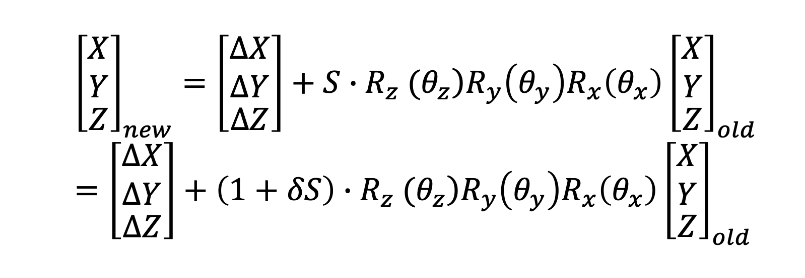

# Coordinate Conversion, Transformation, HK Local System

## 0. Key Concepts
1. Conversion : 坐标体系不变，但是表达方式不同，例如三维坐标系（X,Y,Z）和球坐标系（R,θ,φ）之间的互相转换。在同样的 coordinate Framework。
2. Transformation : 同一个位置，在不同坐标体系下的不同坐标值。 不同的Coordinate Framework。

## 1. 旋转矩阵
1. 二维旋转矩阵
$$
\begin{bmatrix}
x'\\
y'
\end{bmatrix}
=
\begin{bmatrix}
\cos(\theta) & -\sin(\theta)\\
\sin(\theta) & \cos(\theta)
\end{bmatrix}
\begin{bmatrix}
x\\
y
\end{bmatrix}
$$

2. 三维旋转矩阵
- Property of the Rotation Matrix 3D Coordinate Transformation
  - Their inverse is equal to their transpose.
  - Their transpose is same as the operation of -𝜃
  - If we continuously rotate two angles around the same axis counterclockwise. If we rotate angles around the same axis in counterclockwise and clockwise directions. **However, we cannot reverse the order of the rotation.**
- If one coordinate system rotates around X-axis clockwise by 10° first, then Z axis counterclockwise 20° , then Y axis clockwise 30°. Then coordinate transformation is:
$$
\begin{bmatrix}
x'\\
y'\\
z'
\end{bmatrix}
=
R_y(-30)R_z(20)R_x(-10) 
\begin{bmatrix}
x\\
y\\
z
\end{bmatrix}
$$

Please note the order of the rotation matrix. **距离越近的旋转矩阵越先乘。**

3. If the rotation angles are very small, as this is the case in many coordinate transformation, we can simplify the rotation matrix.

- 𝑅𝑠 is an anti-symmetric (or skew-symmetric) matrix.

- Helmert transformation, It is often called seven-parameter transformation (three rotations, three translations, and one scale factor).

## 2. 坐标转换 Conversion

## 3. Geodetic System 1984 (WGS84)

## 4. Hong Kong Local Coordinate System