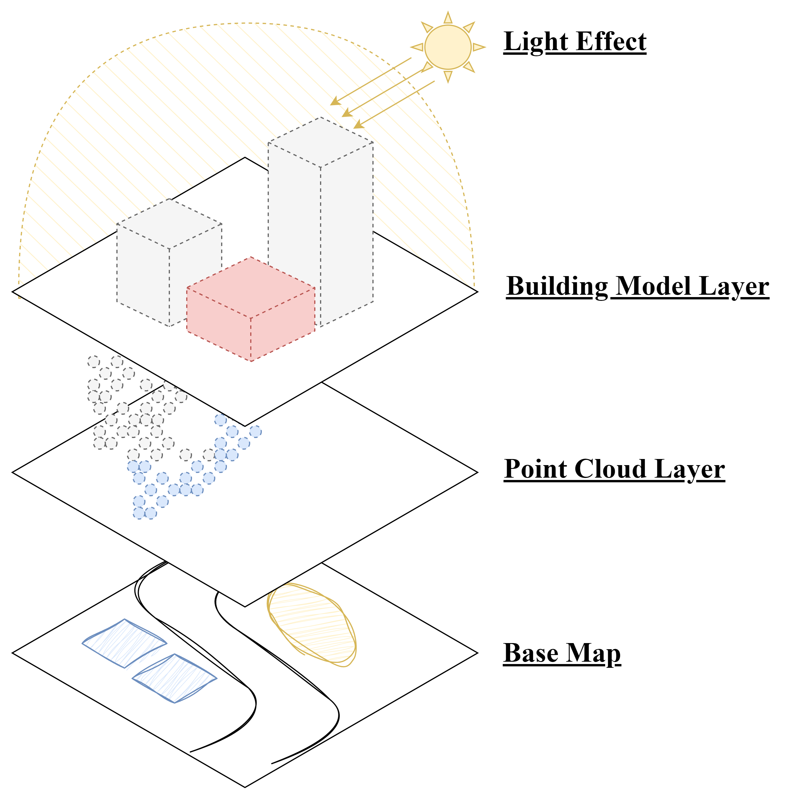

# 虚拟校园模型构建与可视化 (3D Modeling and Visualization) 
> - https://docs.google.com/document/d/1-wAeyA5IplzzYMVzc8FmvI4EIS7DpYBGTL_L7yDdHIc/edit?usp=sharing

## 1. 技术路线与构建思路

虚拟三维校园的搭建需要考虑到诸多问题，三维场景的搭建、点云加载与渲染、融合基础图层及光照系统等。虚拟校园的功能性要强于一般的二维 WebGIS 项目，因此其技术复杂度相较于传统的二维GIS而言也要要高出不少。虚拟三维校园的搭建大致可以采用混合图层的思路，将底图展示、点云渲染、交互控制分配到不同的抽象图层。

Virtual 3D campus construction needs to consider many issues, such as 3D scene construction, point cloud loading and rendering, fusion of basic layers, and lighting systems. The functionality of the virtual campus is stronger than that of a general 2D WebGIS project, so its technical complexity is also much higher than that of traditional 2D GIS. The construction of a virtual 3D campus can be roughly carried out using the idea of hybrid layers, distributing base map display, point cloud rendering, and interactive control to different abstract layers.

考虑到需要在三维场景中进行点云数据的可视化，一般的二维地图引擎就不足以支撑本项目的需求。此外，项目不希望丢失地图底图带来的额外的定位信息，故采用一种混合图层的方式来进行三维场景的构建，即将三维模型与二维地图进行融合，形成一个三维混合图层。该图层可以在三维场景中进行漫游、导航、交互等操作，同时用户也可以借助二维地图来辅助判断当前场景的方位。

Given the need to visualize point cloud data in a 3D scene, a general 2D map engine is insufficient to support the needs of this project. In addition, the project does not want to lose the additional positioning information provided by the map base layer, so a hybrid layer approach is used to construct the 3D scene, which integrates 3D models with 2D maps to form a 3D hybrid layer. This layer allows for roaming, navigation, and interaction in the 3D scene, while users can also use the 2D map to assist in determining the orientation of the current scene.

> Figure 1: 三维混合图层 Hybrid Layer in 3D Scene

混合图层大致可以分为三层。最底层是基础底图（由 OpenStreetMap 提供数据，MapLibre 渲染），本质是一个二维漫游底图，用于承载三维点云及建筑模型并提供额外的地理方位信息。中间层是带有纹理的点云图层，该图层采用 3D Tiles 格式的点云数据，可以最大限度的高性能渲染具有真实感的校园场景。最上层建筑模型层，该层也提供诸如点选、量测等交互功能，一定程度上弥补了点云数据难以交互的不足。此外，还需要考虑向场景中引入光照系统来进一步优化视觉效果，增强真实感。

The hybrid scene can be roughly divided into three layers. The bottom layer is the base map (data provided by OpenStreetMap, rendered by MapLibre), which is essentially a 2D roaming base map used to carry 3D point clouds and building models while providing additional geographic orientation information. The middle layer is the textured point cloud layer, which uses 3D Tiles format point cloud data to maximize high-performance rendering of realistic campus scenes. The top layer is the building model layer, which also provides interactive functions such as point selection and measurement, partially compensating for the lack of interactivity in point cloud data. In addition, it is necessary to consider introducing a lighting system into the scene to further optimize visual effects and enhance realism.

## 4.2.1 Overview of platform development
本平台的开发技术路线如Figure ?所示，可以分为数据提供及用户界面两个大的部分。虚拟校园模型采用二三维混合的方式进行展示，故而数据及用户界面也分为对应的两部分。

The development technology route of this platform is shown in Figure ?, which can be divided into two main parts: data provision and user interface. The virtual campus model is displayed in a hybrid 2D and 3D manner, so the data and user interface are also divided into corresponding two parts.

数据部分，我们将数据托管在 Cesium Ion 平台上，该平台可以对外提供 3D Tiles 格式的三维数据服务。对于 3d 点云（.las），cesium 可以自动识别数据格式并实现转换。但是对于 3d 模型，我们需要在一开始就将多面体（.shp）转换为中间格式。该格式可以被 Cesium Ion 识别。然后，我们将 .kml 和 .dae一起上传，并获得 3D Tiles 格式的模型。转换过程耗时较长。

For the data part, we host the data on the Cesium Ion platform, which can provide 3D Tiles format 3D data services. For 3D point clouds (.las), Cesium can automatically recognize the data format and perform conversion. However, for 3D models, we need to convert the polyhedron (.shp) to an intermediate format from the beginning. This format can be recognized by Cesium Ion. Then, we upload .kml and .dae together and obtain the 3D Tiles format model. The conversion process takes a long time.

用户界面部分，我们采用 Vue.js 作为前端框架，结合 Deck.js 和 MapLibre.js 进行二三纬混合地图组渲染，用户交互体验更加接近于传统的二维地图，易于使用。Cesium.js 具有更加真实的地球模型及光照效果，所以我们使用 Cesium.js 进行纯三维场景表现。项目采用“图层”的概念来抽象表达不同的数据类型，底图层、点云-建筑模型层及三维场景分别对应于 MapLibre.js、Deck.js 和 Cesium.js。用户可以在不同的图层之间进行切换，选择不同的视角来观察校园模型。此外，我们还设计并实现了二维界面用于非空间信息展示及参数控制。

When it comes to the user interface part, we use Vue.js as the front-end framework, combined with Deck.js and MapLibre.js for rendering the mixed 2D and 3D map group, making the user interaction experience more similar to traditional 2D maps and easier to use. Cesium.js has a more realistic Earth model and lighting effects, so we use Cesium.js for pure 3D scene representation. The project uses the concept of "layers" to abstractly express different data types, with the base map layer, point cloud-building model layer, and 3D scene corresponding to MapLibre.js, Deck.js, and Cesium.js respectively. Users can switch between different layers and choose different perspectives to observe the campus model. In addition, we also designed and implemented a 2D interface for non-spatial information display and parameter control.

## 4.2.2 The user interface design and functionality

> Figure ?: User interface of the virtual campus platform. (1) Layer control component; (2) Lighting control component; (3) Detailed information display component; (4) 2D-3D hybrid map component; (5) Information card component.

用户界面由五部分组成，分别是：(1) 图层控制组件；(2) 光照控制组件；(3) 详细信息展示组件；(4) 二三维混合地图组件；(5) 信息卡片组件。界面采用采用数据流双向绑定及组件化设计，组件中的改动可以及时反映到地图上，地图上的操作（例如点选等）也会反作用于组件。用户可以通过图层控制组件和光照控制组件来控制三维场景的显示效果。详细信息展示组件用于展示建筑物的详细信息，二三维混合地图组件用于展示二三维混合地图，信息卡片组件用于展示建筑物的基本信息。

The user interface consists of five parts: (1) Layer control component; (2) Lighting control component; (3) Detailed information display component; (4) 2D-3D hybrid map component; (5) Information card component. The interface adopts a data flow bidirectional binding and componentized design, allowing changes in the components to be reflected on the map in real-time, and operations on the map (such as point selection) to also affect the components. Users can control the display effects of the 3D scene through the layer control component and lighting control component. The detailed information display component is used to show detailed information about buildings, the 2D-3D hybrid map component is used to display the hybrid map, and the information card component is used to show basic information about buildings.

> Figure?: Layer control component and Lighting control component. (a) Layer control component; (b) Lighting control component.
 
The layer control component is designed to be user-friendly, allowing users to easily switch between different layers and adjust the rendering order of the layers. The layer control component can automatically trigger the re-rendering function of the map when the user switches layers, ensuring that the map is always displayed in the correct order. The layer control component also allows users to adjust the transparency of each layer, enabling them to see the underlying layers while still being able to view the top layer. This feature is particularly useful for users who want to compare different layers or see how different layers interact with each other. The lighting control component is used to control the lighting effect of the scene. Users can adjust the light source direction, intensity, and color through the lighting control component to achieve different lighting effects. All the changes made by the user will call re-rendering functions to update the map and other related components. 

前文提到的 3D Hybrid Layer (3.3.1)，该图层可以同时渲染三维点云、建筑模型及二维地图。该图层托管于 Deck.gl 对象上，该对象可以同时渲染目标图层并混合各种预设光照效果。使用该对象预留的接口可以实现对图层渲染、刷新、交互等操作的控制。二维信息组件采用两种形式展示，分别是信息卡片组件和抽屉形式的列表组件。信息卡片组件用于展示选定的建筑物的基本信息（如名称编号等），抽屉形式的列表组件可以响应地图中的点击事件，高亮被选中的建筑物，并展示建筑物的详细信息。

As mentioned earlier, the 3D Hybrid Layer (3.3.1) can render 3D point clouds, building models, and 2D maps simultaneously. This layer is hosted on the Deck.gl object, which can render target layers and mix various preset lighting effects. The reserved interfaces of this object can control operations such as layer rendering, refreshing, and interaction. The 2D information component is displayed in two forms: the information card component and the drawer-style list component. The information card component is used to display basic information (such as name and ID) of the selected building, while the drawer-style list component can respond to click events on the map, highlighting the selected building and displaying detailed information about it.

> Figure?: Day and night simulation. (a) Daytime scene; (b) Nighttime scene.

用户可以通过控制光照参数来实现昼夜模拟效果。该功能可以通过调整光源的方向、强度和颜色来实现。例如，日间阳光为白色平行光，照射角度大约在一定的范围内，光源强度较大；而夜间则可以模拟月光或路灯的照射，光源强度较小，颜色偏蓝。此外，若有路灯或其他光源的地理位置，用户还可以添加点光源以模拟夜间人造光源发光效果，最大限度营造真实感。

The user can achieve a day-night simulation effect by controlling lighting parameters. This function can be implemented by adjusting the direction, intensity, and color of the light source. For example, during the daytime, sunlight is white parallel light with an angle of incidence within a certain range and high intensity; at night, moonlight or streetlight illumination can be simulated with lower intensity and a bluish color. In addition, if there are geographic locations of streetlights or other light sources, point light sources can be added to simulate the glowing effect of artificial light sources at night, maximizing realism.

## 4.2.3 3D Scene rendering and switching
RGB点云加载显示：
光线追踪，模拟昼夜：
## 4.2.4 Building selecting and attribute viewing

## 5. Expected Outcomes（想象的，展望，下一步未来怎么做等）

本项目初步探索了基于 LiDAR 和遥感技术的三维虚拟校园平台构建，就三维场景下的多种数据融合、点云渲染、光照系统等问题进行了初步的探索。本项目为三维虚拟校园平台建设提供一个良好的基础，后续可以在此基础上进行进一步的探索与研究，与具体校园地理信息应用相结合，提供更为丰富的校园信息展示及交互功能。

### 5.3. 虚拟校园的典型应用场景展示

虚拟校园的一个核心功能就是校园漫游与导览功能，用户置身于陌生的校园中，能够通过虚拟校园平台快速了解校园的空间布局、建筑分布、设施位置等信息。一般的二维地图只能提供平面信息，对于具有多层结构、及密集建筑的校园而言，二维地图的展示效果往往不尽如人意。结合三维点云数据、三维建筑模型数据构建的校园沙盘导览系统，可以为用户提供更为直观的三维校园漫游体验。此外，还可以与 VR、AR 等技术结合，提供更为沉浸式的校园漫游体验，让远在异地的用户也能身临其境的感受校园的魅力。若与在线社交平台相结合，用户还可以在漫游过程中与其他用户进行实时互动，分享校园生活的点滴。

One of the core functions of the virtual campus is campus roaming and guided tours. When users find themselves in an unfamiliar campus, the virtual campus platform allows them to quickly understand the spatial layout, building distribution, and facility locations. Traditional 2D maps can only provide flat information, which often falls short for campuses with multi-layered structures and dense buildings. By integrating 3D point cloud data and 3D building model data, a campus sandbox navigation system can offer users a more intuitive 3D campus roaming experience. Additionally, combining this with VR and AR technologies can provide an even more immersive campus tour experience, enabling remote users to feel as if they are physically present and experiencing the charm of the campus. If integrated with online social platforms, users can also interact with others in real-time during their virtual tours, sharing moments of campus life.

与高精度校园矢量数据相结合，再结合校园的三维点云数据，虚拟校园平台也可以为用户提供更为便捷的校园导航服务。虚拟校园平台可以生成三维导航路线图，比起一般的二维地图，三维导航路线图更加适用于小而建筑密集的校园环境。用户可以通过虚拟校园平台快速获取到达目的地的最佳路径、所需时间、交通方式等信息。此外，用户还可以通过虚拟校园平台进行室内导航，帮助用户快速找到教室、实验室、图书馆等设施的位置。

Combining with high-precision campus vector data and the 3D point cloud data of the campus, the virtual campus platform can also provide users with more convenient campus navigation services. The virtual campus platform can generate a 3D navigation route map, which is more suitable for small and densely built campus environments than ordinary 2D maps. Users can quickly obtain information such as the best path to their destination, required time, and transportation methods through the virtual campus platform. In addition, users can also use the virtual campus platform for indoor navigation, helping them quickly find the locations of classrooms, laboratories, libraries, and other facilities.

虚拟校园平台还可以与校园的智能硬件及BIM相结合，提供高精度的校园设施定位与管理服务。校园设施管理处可以通过虚拟校园平台实时监控校园内的设施状态，及时发现并处理设施故障。校园安保处可以通过虚拟校园平台实时查看校园内的安防监控视频，及时发现并快速定位校园内的异常情况。校园后勤处可以通过虚拟校园平台实时查看校园内的物流信息，及时处理校园内的物品配送。普通用户可以享受智能硬件带来高精度室内定位服务。普通用户还可以享受智能硬件带来的高精度校园设施定位服务，如快速找到校园内的各种小型设施的三维位置，如饮水机、垃圾桶、座椅等。

Campus facilities management, security, and logistics can also be integrated with the virtual campus platform to provide high-precision campus facility location and management services. The campus facilities management office can monitor the status of facilities in real-time through the virtual campus platform, promptly identifying and addressing facility malfunctions. The campus security office can view security surveillance videos in real-time through the virtual campus platform, quickly detecting and locating abnormal situations on campus. The campus logistics office can view logistics information on campus in real-time through the virtual campus platform, promptly handling item deliveries on campus. Ordinary users can enjoy high-precision indoor positioning services brought by smart hardware. Ordinary users can also enjoy high-precision campus facility location services brought by smart hardware, such as quickly finding the three-dimensional locations of various small facilities on campus, such as drinking fountains, trash cans, benches, etc.

对于紧急情况，如火灾地震等，借助于虚拟校园平台可以更好的做出应急预案。用户也可以快速获取最近的安全出口、避难所等信息。学校也可以通过虚拟校园平台快速发布紧急通知，及时通知到每一位师生。学校还可以通过虚拟校园平台快速发布应急预案，及时处理突发事件。

For emergency situations such as fires and earthquakes, the virtual campus platform can help make better emergency plans. Users can quickly obtain information about the nearest emergency exits, shelters, etc. The school can also quickly publish emergency notifications through the virtual campus platform, ensuring timely communication with every student and faculty member. Additionally, the school can quickly release emergency plans through the virtual campus platform to address unexpected events.

三维虚拟校园平台有诸多独特的优势，相较于二维地图而言，可以提供更为直观的空间信息传达与交互体验。对于校友而言，虚拟校园漫游可以帮助他们重温校园时光，回忆起在校园中的点滴。对于新生而言，虚拟校园漫游可以帮助他们快速熟悉校园环境，了解学校的各项设施与资源。对于校外人员而言，虚拟校园漫游可以帮助他们更好的了解学校的历史、文化、建筑等信息。可以说，虚拟校园平台完全可以成为元宇宙世界中的孪生校园，对外界提供比肩于现实校园体验与功能。

The 3D virtual campus platform has many unique advantages. Compared to 2D maps, it can provide a more intuitive spatial information transmission and interactive experience. For alumni, virtual campus tours can help them relive their campus days and recall the moments spent on campus. For new students, virtual campus tours can help them quickly familiarize themselves with the campus environment and understand the school's facilities and resources. For external visitors, virtual campus tours can help them better understand the school's history, culture, architecture, and other information. It can be said that the virtual campus platform can completely become a twin campus in the metaverse world, providing an experience and functionality comparable to that of a real campus.

high precision campus vector data, 3D point cloud data, and virtual campus platform can also be used in other fields. For example, they can be used in urban planning, disaster prevention and mitigation, environmental monitoring, and other fields. The virtual campus platform can provide a more intuitive and interactive experience for users in these fields, helping them better understand the spatial information and make better decisions.

## 1. Introduction (可以增加一个框图)

研究背景 (Background) 
LiDAR技术与遥感技术简介
虚拟校园建设的必要性与应用场景

研究目的 (Objectives) 
构建精准、高效的PolyU校园三维虚拟模型
探索LiDAR与遥感技术在高校数字化建设中的潜力

研究意义 (Significance) 
促进校园管理与规划、虚拟仿真教育、以及增强现实（AR）应用

2. Literature Review
LiDAR技术的原理与发展现状

The principle and development status of LiDAR technology

遥感技术在建筑三维建模与地物分类中的应用

The application of remote sensing technology in 3D modeling and object classification

虚拟校园建设案例分析（国内外高校的经验）

The analysis of virtual campus construction cases (experiences of domestic and foreign universities)

PolyU校园现有三维数据或地理空间信息建设现状
