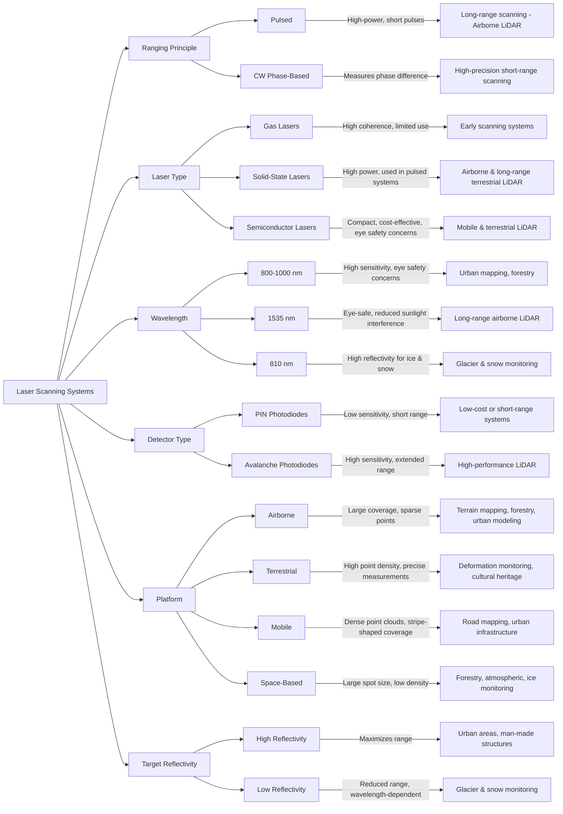

### **Simplified Table: Classification of Laser Scanning Systems**  

```py
def test():
    print("Hello World")
```
```sh
pandoc test.md -o test.docx --highlight-style=tango
```

test formular of normal distribution
$$
f(x) = \frac{1}{\sigma \sqrt{2\pi}} e^{-\frac{1}{2} \left(\frac{x-\mu}{\sigma}\right)^2}
$$


| **Category**         | **Subtype**                 | **Key Characteristics**                        | **Typical Applications**                      |
|----------------------|----------------------------|------------------------------------------------|-----------------------------------------------|
| **Ranging Principle** | Pulsed                     | High-power, short-pulse lasers                 | Long-range scanning (e.g., airborne LiDAR)   |
|                      | CW Phase-Based             | Measures phase difference of modulated light   | High-precision short-range scanning          |
| **Laser Type**       | Gas Lasers                 | High coherence, limited modern use             | Early scanning systems                       |
|                      | Solid-State Lasers         | High power, used in pulsed systems             | Airborne and long-range terrestrial LiDAR    |
|                      | Semiconductor Lasers       | Compact, cost-effective, eye safety concerns   | Mobile and terrestrial LiDAR                 |
| **Wavelength**       | 800–1000 nm                | High sensitivity, eye safety concerns          | Urban mapping, forestry                      |
|                      | 1535 nm                    | Eye-safe, reduced sunlight interference        | Long-range airborne LiDAR                    |
|                      | 810 nm                     | High reflectivity for ice and snow             | Glacier and snow monitoring                  |
| **Detector Type**    | PIN Photodiodes            | Low sensitivity, short range                   | Low-cost or short-range systems              |
|                      | Avalanche Photodiodes (APD) | High sensitivity, extended range               | High-performance LiDAR                        |
| **Platform**         | Airborne                   | Large coverage, sparse points                  | Terrain mapping, forestry, urban modeling    |
|                      | Terrestrial                | High point density, precise measurements       | Deformation monitoring, cultural heritage     |
|                      | Mobile                     | Dense point clouds, stripe-shaped coverage     | Road mapping, urban infrastructure           |
|                      | Space-Based                | Large spot size, low density                   | Forestry, atmospheric, ice monitoring        |
| **Target Reflectivity** | High Reflectivity        | Maximizes range                                | Urban areas, man-made structures             |
|                      | Low Reflectivity           | Reduced range, wavelength-dependent            | Glacier and snow monitoring                  |  


